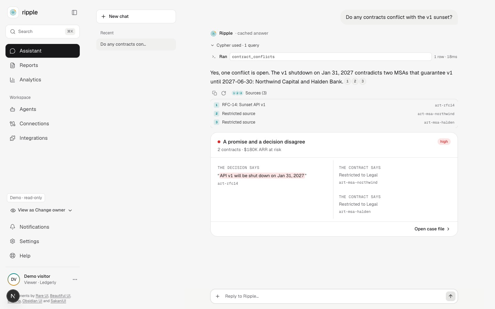
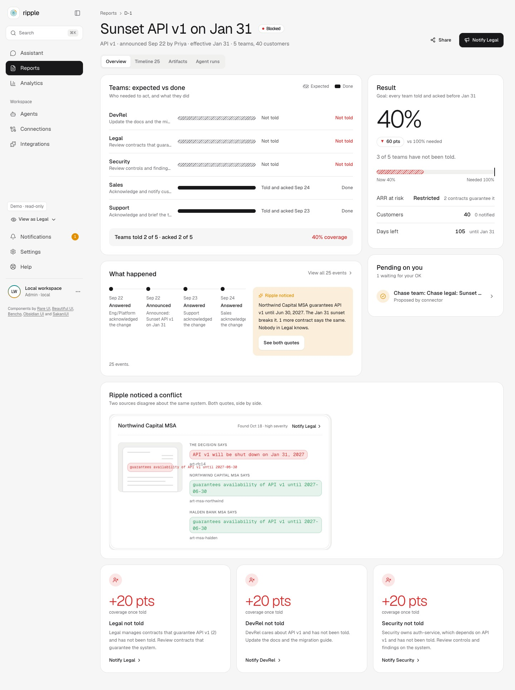
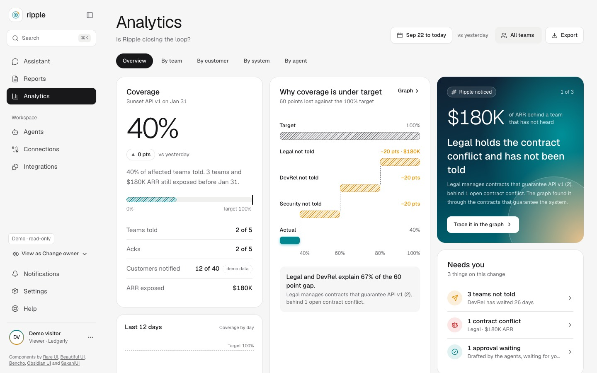
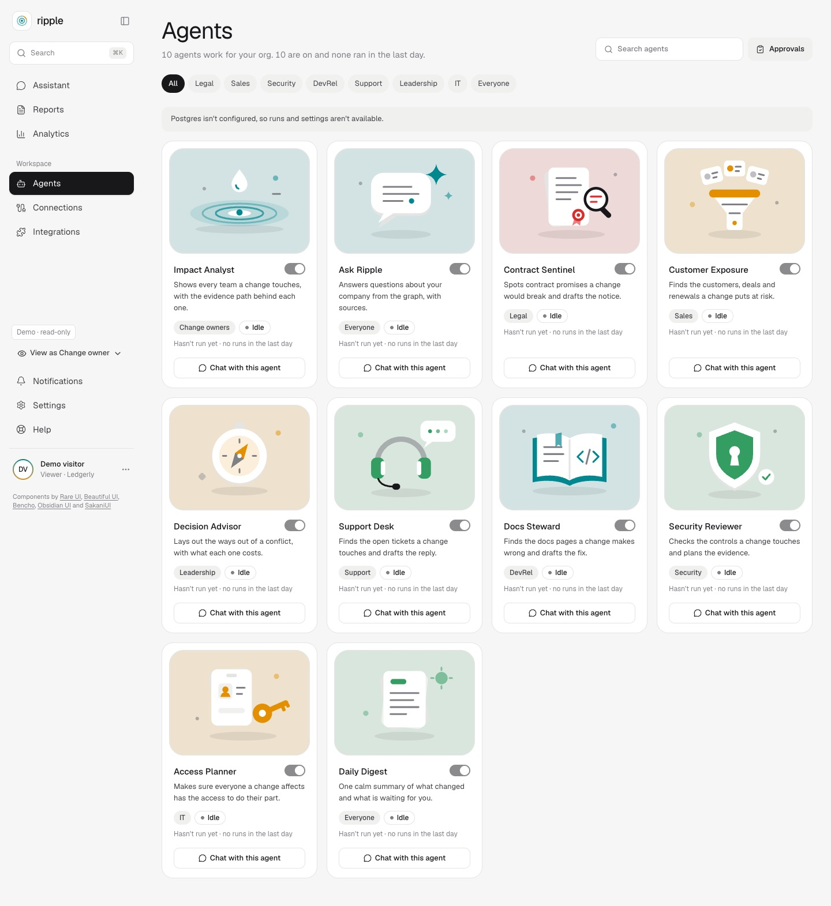
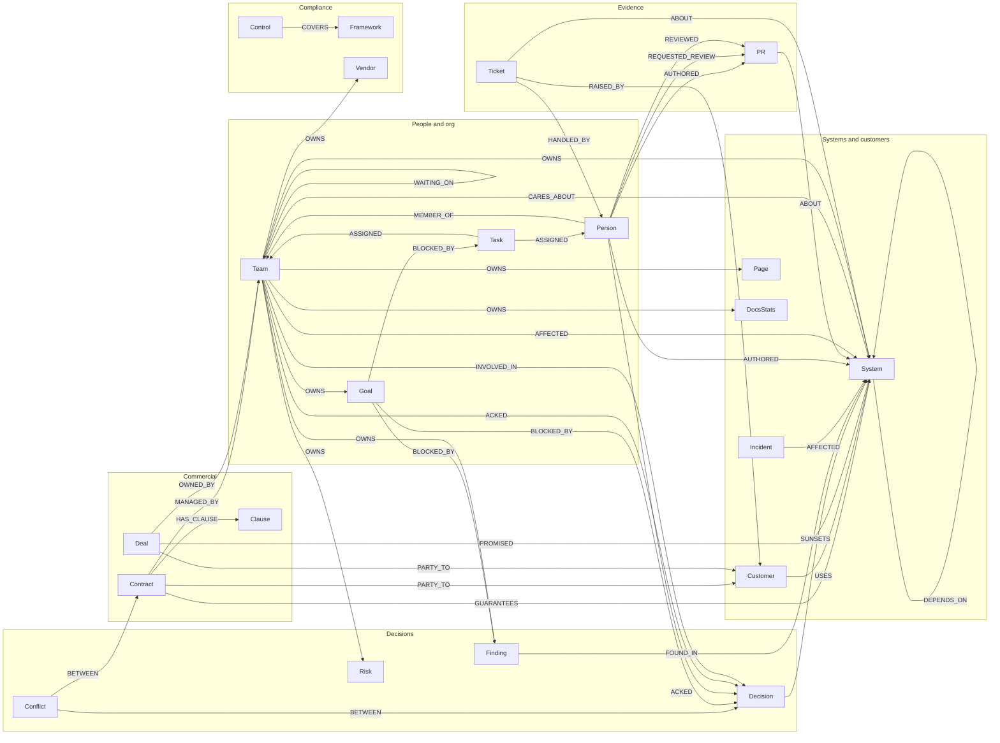
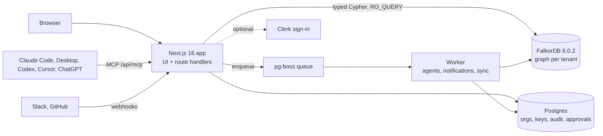

<p align="center"></p>

<h1 align="center">Ripple</h1>

**A company brain on FalkorDB: change one decision and see every team, customer and contract it ripples into, with the receipts.**

[Live demo](https://ripple.vaibhav.quest) · [Demo walkthrough](#demo-walkthrough) · [Self-host in 5 minutes](SELF_HOSTING.md) · WeMakeDevs x FalkorDB Graph Hacks, Track 03 (Company Brain)

> Mirror: https://web-2fa0-3000.prg1.zerops.app (same deployment, Zerops subdomain).

## The 60-second pitch

Every company makes decisions that ripple across teams, and the people who need to know usually find out last. Connecting an agent to Jira, Zendesk and the CRM gives it lookups, not an understanding of how a decision travels through a company. **Tools are not context.**

Ripple puts the decision, the systems that depend on it, the customers, deals and contracts on those systems, and the teams that own them into one FalkorDB graph. "What does this touch, and who hasn't heard?" becomes a single traversal instead of a hundred API calls. Telling a team is an edge (`INVOLVED_IN`, `ACKED`), so a **missing edge is the finding**. Every edge carries the artifact it came from and a verbatim quote, every answer shows the Cypher it ran, and when nothing in the graph connects, Ripple says so instead of guessing.

The demo company, **Ledgerly**, has decided to sunset API v1. Ripple finds 40 customers and 180,000 of ARR on it, two contracts that guarantee v1 past the sunset date, and three teams (Legal, Security, DevRel) that were never told.

## Demo walkthrough

<!-- H3: when docs/demo.gif is committed, add  here -->
The walkthrough GIF is coming; until then the live demo is the demo: <https://ripple.vaibhav.quest>.

Prefer to click: open the [live demo](https://ripple.vaibhav.quest), ask the Assistant "We're removing API v1. What breaks, and who doesn't know yet?", then follow the case file. The three-minute path is in [docs/demo-script.md](docs/demo-script.md).

## What it does

| | |
|---|---|
|  **Assistant** (`/`): ask in plain language; the model picks one of a fixed set of Cypher-backed tools and never writes Cypher. |  **Reports and case files** (`/reports`, `/reports/d-1`): the ripple, the gap, the conflict, each claim with its source quote. |
|  **Analytics** (`/analytics`): forecast, leakage and the embedded graph explorer, all read from the same graph. |  **Agents** (`/agents`): templates that run read-only against the graph; anything that would write returns a preview for approval. |

- **Connections** (`/connections`): GitHub, Slack, CSV and file upload feed artifacts into the graph; extraction keeps only edges whose quote is verbatim in the source.
- **Integrations** (`/integrations`): copy-paste setup for every AI client, filled with the deployment's own URL, plus API keys. See [Use Ripple from your AI tools](#use-ripple-from-your-ai-tools).
- **Settings and Profile** (`/settings`, `/profile`): members, notifications and API keys, plus your own profile.
- **Acknowledgements.** Each brief carries a signed link; one click ("seen", "concern", "not relevant") writes an `ACKED` edge and the gap closes.

## The graph

Ripple is a graph product, so the graph is the first thing to read. Both sections below are generated from a freshly seeded graph by `pnpm graph:readme` (`scripts/graph-map.ts`, `scripts/graph-proof.ts`); nothing in them is hand-written output.

### Graph map

<!-- graph-map:start -->


Generated from the seeded graph by `scripts/graph-map.ts`: 29 node labels and 27 relationship types (289 nodes, 466 edges), drawn as 42 distinct (label, type, label) shapes across 27 types. `Artifact` is a second label on every Doc, Ticket, Message and PR; `Decision` also carries `Change`.

- **Temporal edges.** Every relationship carries `valid_from` and `valid_to` (epoch seconds; no `valid_to` means current) plus `observed_at`. Ended edges are kept, so "what was true on date X" and "what changed" are plain `WHERE` clauses.
- **Evidence on the edge.** Extracted edges carry `src` (the artifact id) and `quote` (a verbatim substring of it). A quote that is not in the artifact is dropped at ingest.
- **Absence is data.** Telling a team is an edge (`INVOLVED_IN`, `ACKED`), so a team the decision reaches with no such edge is the finding.
- Index coverage: 27 labels have an `id` lookup index; `Artifact` also has a full-text and a 384-d vector index.
<!-- graph-map:end -->

### The graph does the work

Three real queries from `lib/graph/queries/`, run against the seeded graph.

<!-- graph-proof:start -->
Measured on a freshly seeded graph for decision `d-1` ("Sunset API v1"), `GRAPH.RO_QUERY` from a Node client to FalkorDB 6.0.2 on the same machine, one warm-up then the median of 5 runs (round trip including the client). Regenerate with `pnpm graph:readme`. Temporal filters evaluate at `$now = 2026-10-17`.

#### 1. The ripple: what does the decision touch?

`lib/graph/queries/ripple.cypher`: **80 rows, 3.5 ms** (runs: 6.1, 3.5, 3.7, 3.5, 3.3 ms)

| branch (kind) | rows | examples |
|---|---|---|
| system | 4 | API v1; auth-service; api-gateway (+1 more) |
| ticket | 12 | Cobalt Health: API v1 errors; Delta Retail: API v1 errors; Ember Energy: API v1… |
| deal | 3 | Garnet Energy expansion; Harbor Labs expansion; Alder Freight expansion |
| contract | 2 | Northwind Capital MSA; Halden Bank MSA |
| customer | 40 | Northwind Capital; Halden Bank; Cobalt Health (+37 more) |
| team | 19 | security; devrel; support (+2 more) |

<details><summary>Cypher</summary>

```cypher
// Everything a decision touches: SUNSETS -> system <- DEPENDS_ON*0..2 dependents, then
// entities (tickets, deals, contracts, customers) and the teams that own/handle/care.
// Row: kind, ref, label, sys, hop, rel, team, reason, src, quote, amount. UNION ALL branches.
MATCH (d:Decision {id: $id})-[sn:SUNSETS]->(s:System)
WHERE sn.valid_to IS NULL
MATCH p = (s)<-[:DEPENDS_ON*0..2]-(x:System)
WHERE ALL(e IN relationships(p) WHERE e.valid_to IS NULL)
RETURN 'system' AS kind, x.id AS ref, x.name AS label,
  CASE WHEN length(p) = 0 THEN null ELSE nodes(p)[length(p) - 1].id END AS sys,
  length(p) + 1 AS hop, 'DEPENDS_ON' AS rel, null AS team, null AS reason, null AS src, null AS quote, 0 AS amount
UNION ALL
MATCH (d:Decision {id: $id})-[sn:SUNSETS]->(s:System)
WHERE sn.valid_to IS NULL
MATCH p = (s)<-[:DEPENDS_ON*0..2]-(x:System)
WHERE ALL(e IN relationships(p) WHERE e.valid_to IS NULL)
MATCH (a:Ticket {status: 'open'})-[r:ABOUT]->(x) WHERE r.valid_to IS NULL
RETURN 'ticket' AS kind, a.id AS ref, a.title AS label, x.id AS sys, length(p) + 2 AS hop, 'ABOUT' AS rel,
  null AS team, null AS reason, r.src AS src, r.quote AS quote, 0 AS amount
UNION ALL
MATCH (d:Decision {id: $id})-[sn:SUNSETS]->(s:System)
WHERE sn.valid_to IS NULL
MATCH p = (s)<-[:DEPENDS_ON*0..2]-(x:System)
WHERE ALL(e IN relationships(p) WHERE e.valid_to IS NULL)
MATCH (dl:Deal)-[r:PROMISED]->(x) WHERE r.valid_to IS NULL AND dl.stage <> 'closed_lost'
RETURN 'deal' AS kind, dl.id AS ref, dl.name AS label, x.id AS sys, length(p) + 2 AS hop, 'PROMISED' AS rel,
  null AS team, null AS reason, r.src AS src, r.quote AS quote, dl.amount AS amount
UNION ALL
MATCH (d:Decision {id: $id})-[sn:SUNSETS]->(s:System)
WHERE sn.valid_to IS NULL
MATCH p = (s)<-[:DEPENDS_ON*0..2]-(x:System)
WHERE ALL(e IN relationships(p) WHERE e.valid_to IS NULL)
MATCH (c:Contract)-[r:GUARANTEES]->(x) WHERE r.valid_to IS NULL
MATCH (c)-[:PARTY_TO]->(cu:Customer)
RETURN 'contract' AS kind, c.id AS ref, c.name AS label, x.id AS sys, length(p) + 2 AS hop, 'GUARANTEES' AS rel,
  null AS team, null AS reason, r.src AS src, r.quote AS quote, cu.arr AS amount
UNION ALL
MATCH (d:Decision {id: $id})-[sn:SUNSETS]->(s:System)
WHERE sn.valid_to IS NULL
MATCH p = (s)<-[:DEPENDS_ON*0..2]-(x:System)
WHERE ALL(e IN relationships(p) WHERE e.valid_to IS NULL)
MATCH (cu:Customer)-[r:USES]->(x) WHERE r.valid_to IS NULL AND r.last_seen >= $now - 120 * 86400
RETURN 'customer' AS kind, cu.id AS ref, cu.name AS label, x.id AS sys, length(p) + 2 AS hop, 'USES' AS rel,
  null AS team, null AS reason, r.src AS src, r.quote AS quote, cu.arr AS amount
UNION ALL
MATCH (d:Decision {id: $id})-[sn:SUNSETS]->(s:System)
WHERE sn.valid_to IS NULL
MATCH p = (s)<-[:DEPENDS_ON*0..2]-(x:System)
WHERE ALL(e IN relationships(p) WHERE e.valid_to IS NULL)
MATCH (t:Team)-[r:OWNS]->(x) WHERE r.valid_to IS NULL AND NOT (t)-[:OWNS]->(s)
RETURN 'team' AS kind, x.id AS ref, x.name AS label, x.id AS sys, 0 AS hop, 'OWNS' AS rel,
  t.id AS team, 'owns ' + x.name + ', which depends on ' + s.name AS reason, r.src AS src, r.quote AS quote, 0 AS amount
UNION ALL
MATCH (d:Decision {id: $id})-[sn:SUNSETS]->(s:System)
WHERE sn.valid_to IS NULL
MATCH p = (s)<-[:DEPENDS_ON*0..2]-(x:System)
WHERE ALL(e IN relationships(p) WHERE e.valid_to IS NULL)
MATCH (t:Team)-[r:CARES_ABOUT]->(x) WHERE r.valid_to IS NULL
RETURN 'team' AS kind, x.id AS ref, x.name AS label, x.id AS sys, 0 AS hop, 'CARES_ABOUT' AS rel,
  t.id AS team, 'cares about ' + x.name AS reason, r.src AS src, r.quote AS quote, 0 AS amount
UNION ALL
MATCH (d:Decision {id: $id})-[sn:SUNSETS]->(s:System)
WHERE sn.valid_to IS NULL
MATCH p = (s)<-[:DEPENDS_ON*0..2]-(x:System)
WHERE ALL(e IN relationships(p) WHERE e.valid_to IS NULL)
MATCH (a:Ticket {status: 'open'})-[r:ABOUT]->(x) WHERE r.valid_to IS NULL
MATCH (a)-[:HANDLED_BY]->(:Person)-[:MEMBER_OF]->(t:Team)
RETURN 'team' AS kind, a.id AS ref, a.title AS label, x.id AS sys, 0 AS hop, 'HANDLED_BY' AS rel,
  t.id AS team, 'handles open tickets about ' + x.name AS reason, r.src AS src, r.quote AS quote, 0 AS amount
UNION ALL
MATCH (d:Decision {id: $id})-[sn:SUNSETS]->(s:System)
WHERE sn.valid_to IS NULL
MATCH p = (s)<-[:DEPENDS_ON*0..2]-(x:System)
WHERE ALL(e IN relationships(p) WHERE e.valid_to IS NULL)
MATCH (a:Ticket {status: 'open'})-[r:ABOUT]->(x) WHERE r.valid_to IS NULL
MATCH (a)-[:HANDLED_BY]->(t:Team)
RETURN 'team' AS kind, a.id AS ref, a.title AS label, x.id AS sys, 0 AS hop, 'HANDLED_BY' AS rel,
  t.id AS team, 'handles open tickets about ' + x.name AS reason, r.src AS src, r.quote AS quote, 0 AS amount
UNION ALL
MATCH (d:Decision {id: $id})-[sn:SUNSETS]->(s:System)
WHERE sn.valid_to IS NULL
MATCH p = (s)<-[:DEPENDS_ON*0..2]-(x:System)
WHERE ALL(e IN relationships(p) WHERE e.valid_to IS NULL)
MATCH (dl:Deal)-[r:PROMISED]->(x) WHERE r.valid_to IS NULL AND dl.stage <> 'closed_lost'
MATCH (dl)-[:OWNED_BY]->(t:Team)
RETURN 'team' AS kind, dl.id AS ref, dl.name AS label, x.id AS sys, 0 AS hop, 'OWNED_BY' AS rel,
  t.id AS team, 'owns open deals that promised ' + x.name AS reason, r.src AS src, r.quote AS quote, 0 AS amount
UNION ALL
MATCH (d:Decision {id: $id})-[sn:SUNSETS]->(s:System)
WHERE sn.valid_to IS NULL
MATCH p = (s)<-[:DEPENDS_ON*0..2]-(x:System)
WHERE ALL(e IN relationships(p) WHERE e.valid_to IS NULL)
MATCH (c:Contract)-[r:GUARANTEES]->(x) WHERE r.valid_to IS NULL
MATCH (c)-[:MANAGED_BY]->(t:Team)
RETURN 'team' AS kind, c.id AS ref, c.name AS label, x.id AS sys, 0 AS hop, 'MANAGED_BY' AS rel,
  t.id AS team, 'manages contracts that guarantee ' + x.name AS reason, r.src AS src, r.quote AS quote, 0 AS amount
```

</details>

#### 2. The gap: which affected teams were never told?

`lib/graph/queries/gap.cypher`: **5 rows, 0.8 ms** (runs: 0.7, 0.8, 0.9, 1.0, 0.7 ms)

| team | involved | acked | verdict |
|---|---|---|---|
| security | false | false | **never told** |
| devrel | false | false | **never told** |
| sales | true | true | told |
| support | true | true | told |
| legal | false | false | **never told** |

<details><summary>Cypher</summary>

```cypher
// Per affected team: was it involved in, or did it acknowledge, the decision?
MATCH (t:Team) WHERE t.id IN $affected
OPTIONAL MATCH (t)-[i:INVOLVED_IN]->(:Decision {id: $id}) WHERE i.valid_to IS NULL
OPTIONAL MATCH (t)-[a:ACKED]->(:Decision {id: $id}) WHERE a.valid_to IS NULL
RETURN t.id AS team, t.name AS name, count(i) > 0 AS involved, count(a) > 0 AS acked
```

</details>

#### 3. The conflict: a contract guarantees what the decision sunsets

`lib/graph/queries/conflicts-detect.cypher`: **1 rows, 0.6 ms** (runs: 0.7, 0.6, 0.6, 0.6, 0.7 ms)

| system | contracts | sunset source | sunset quote |
|---|---|---|---|
| api-v1 | ["ctr-1","ctr-2"] | art-rfc14 | API v1 will be shut down on Jan 31, 2027 |

<details><summary>Cypher</summary>

```cypher
// A contract guarantees a system past the date the decision sunsets it; both edges current.
MATCH (d:Decision {id: $id})-[s:SUNSETS]->(sys:System)<-[g:GUARANTEES]-(c:Contract)
WHERE s.valid_to IS NULL AND g.valid_to IS NULL AND g.until > s.on
RETURN sys.id AS systemId, collect(c.id) AS contractIds,
  collect({artifactId: g.src, quote: g.quote}) AS guaranteeSources,
  head(collect(s.src)) AS sunsetSrc, head(collect(s.quote)) AS sunsetQuote
```

</details>

**Why this is a graph problem.** The ripple is one statement of 12 `UNION ALL` branches, and every branch starts the same way: from the decision follow `SUNSETS` to a system, then `DEPENDS_ON*0..2` backwards through the dependency chain (up to three systems deep, `depth` raises the bound), keeping only edges whose `valid_to` is null. From each system reached it takes one more hop to the tickets (`ABOUT`), deals (`PROMISED`), contracts (`GUARANTEES` then `PARTY_TO` the customer), customers (`USES`) and teams (`OWNS`, `CARES_ABOUT`, `HANDLED_BY`, `OWNED_BY`, `MANAGED_BY`). In SQL that is a recursive CTE for the dependency walk, then a join per entity table and per ownership table, with the temporal predicate repeated on each join: a dozen branches of several joins each, and the whole shape changes whenever you add one more relationship type. The gap query goes the other way: it is an `OPTIONAL MATCH` for an edge that is not there, so the answer is an absence, which in SQL is a `LEFT JOIN ... IS NULL` per signal. The conflict query is a three-node pattern (decision, system, contract) with a comparison across two different edges (`g.until > s.on`). The temporal filter is not a feature bolted on: it is a property on the same edge the traversal already visits.
<!-- graph-proof:end -->

More of what FalkorDB does here: `shortestPath` for "why is this team affected?" (`why-affected.cypher`), a full-text and a 384-d vector index on `Artifact` (`search.cypher`, `search-vector.cypher`), `algo.SPpaths` over `weight` for the cheapest dependency route, `MERGE` write-back for acks and conflicts, and `GRAPH.RO_QUERY` for every read so a read path cannot write. Quirks we hit are in [docs/reference.md](docs/reference.md#falkordb-gotchas-we-hit).

## Architecture



- **FalkorDB** holds the company graph. Every question is a fixed Cypher template in `lib/graph/queries/`; the LLM chooses a template and fills parameters.
- **Postgres** holds what is not graph-shaped: organisations, API keys (sha256 only), approvals, audit log, and the pg-boss queue.
- **Worker** is the same codebase (`pnpm worker`), running agents, notifications and connector sync.
- **Clerk is optional.** With no keys the app runs in local mode with no login; with an LLM key unset it answers from committed caches.
- Embeddings are local (MiniLM-L6-v2, 384-d) and cached by content hash.

## Use Ripple from your AI tools

The MCP server is stateless Streamable HTTP at `/api/mcp` (17 tools, all read-only except `ack_brief`) or stdio against a local FalkorDB. The hosted demo is anonymous and read-only. **[/integrations](https://ripple.vaibhav.quest/integrations)** has copy buttons for each client below.

**Claude Code**

```bash
# plugin: hosted MCP server + the ripple-impact skill
/plugin marketplace add Vaibhav91one/ripple
/plugin install ripple@ripple

# or just the MCP server
claude mcp add --transport http ripple https://ripple.vaibhav.quest/api/mcp
```

**Claude Desktop and claude.ai.** Customize > Connectors > + > Add custom connector, paste `https://ripple.vaibhav.quest/api/mcp` ("No sign in" for the demo). Skill: zip `skills/ripple-impact` and upload it under Customize > Skills.

**Codex** (`~/.codex/config.toml`)

```toml
[mcp_servers.ripple]
url = "https://ripple.vaibhav.quest/api/mcp"
# for org keys also: bearer_token_env_var = "RIPPLE_API_KEY"
```

The skill ships in `.agents/skills/ripple-impact`; Codex reads `.agents/skills` in a repo.

**Cursor.** One-click "Add to Cursor" on [/integrations](https://ripple.vaibhav.quest/integrations), or `~/.cursor/mcp.json`:

```json
{ "mcpServers": { "ripple": { "url": "https://ripple.vaibhav.quest/api/mcp" } } }
```

**ChatGPT** (demo only). Developer mode connector, no auth, URL `https://ripple.vaibhav.quest/api/mcp`.

**Slack and GitHub.** `/ripple` and @Ripple in Slack, @ripple-company-brain on pull requests. See `/integrations` for setup (manifests: `slack-manifest.yaml`, `github-app-manifest.json`).

**Your own org.** An org admin creates an API key on `/integrations` (shown once, only its sha256 is stored, revocable). It acts as the admin who created it, so restricted text is redacted exactly as in their session. Send `Authorization: Bearer rpl_<prefix>_<secret>` (`claude mcp add ... --header "Authorization: Bearer rpl_<prefix>_<secret>"`) or export `RIPPLE_API_KEY`. Local stdio: `claude mcp add ripple -e FALKORDB_HOST=localhost -e FALKORDB_PORT=6379 -- pnpm --silent mcp`.

## Self-host in 5 minutes

No accounts, no API keys. Needs Docker Compose v2 and about 3 GB of RAM.

```bash
git clone https://github.com/Vaibhav91one/ripple.git
cd ripple/deploy/fallback
cp .env.example .env
docker compose up -d --build
curl http://localhost:3000/api/health
```

Open <http://localhost:3000>; local mode has no login and is published on `127.0.0.1` only. HTTPS, an LLM key, GitHub and Slack are optional, see [SELF_HOSTING.md](SELF_HOSTING.md). Zerops deploy runbook: [docs/deploy.md](docs/deploy.md).

For development: `cp .env.example .env && pnpm i && pnpm seed && pnpm dev` with FalkorDB on `:6379` (`docker run -d -p 6379:6379 falkordb/falkordb:6.0.2`).

## What is real and what is seeded

| Real | Seeded or synthetic |
|---|---|
| The graph engine, schema, indexes and every Cypher template (fixed, parameterised, read-only on read paths) | **The company.** Ledgerly, its people, customers, contracts, tickets and PRs are synthetic (hackathon rule 6 allows it); the artifacts come from the seed, not from a live Jira, Zendesk or HubSpot |
| Quote check at ingest: an edge whose quote is not verbatim in the artifact is dropped | The extraction cache is seeded from mocks; with an LLM key `pnpm extract` fills it and every edge still passes the quote check |
| MCP server, API keys, audit log, approvals, acks writing `ACKED` edges, conflict detection | Some team KPIs are estimated (eng coding and deploy times, support CSAT, devrel adoption) |
| GitHub and Slack connectors, CSV and upload ingestion | The Assistant falls back to cached answers when no LLM key is set; the live deployment uses OpenAI `gpt-5.4` |

`affected_controls` is coarse (a `v1Related` flag; there is no Control-to-System edge). Details and measured numbers: [docs/reference.md](docs/reference.md).

## Testing

- `pnpm test`: unit and route tests (vitest). Graph tests run against a live FalkorDB on throwaway `test_v_<uuid>` graphs.
- `pnpm eval`: 16 questions about Ledgerly answered by the deterministic query wrappers, each checked for its expected source ids (16/16, table in [docs/reference.md](docs/reference.md#eval)).
- `pnpm e2e`: Playwright smoke suite over every route in `e2e/routes.ts` at 1440x900 and 390x844; fails on a bad status or any console error. Run `pnpm build` first.
- `pnpm typecheck`, `pnpm lint`, `pnpm build`; CI also runs the Compose smoke against `/api/health`.
- `pnpm graph:readme` regenerates the graph map and proof above.

## How this was built (AI-use disclosure)

Ripple was built with Claude Code: Claude Opus as the lead agent, Claude Sonnet subagents for parallel issues and research. The author (GitHub [Vaibhav91one](https://github.com/Vaibhav91one)) chose the track and the product (decision impact, "who wasn't told"), the data-model direction, the team workspaces, the UI kits, the Zerops deployment and the scope, and reviewed every PR. Commits carry `Co-Authored-By` trailers.

## Prior art

[Hopper](https://www.falkordb.com/blog/memory-meets-motion-the-falkordb-standouts/) (security advisory to customer to contract clause; "no path = safe") and Drift (decision contradictions from meetings) were standouts at FalkorDB's Memory Meets Motion hackathon. Ripple starts from a company decision, crosses every team, and the finding is the missing `INVOLVED_IN`/`ACKED` edge plus contract conflicts, with acknowledgement write-back.

## Credits and licences

MIT for Ripple's own code, see `LICENSE`. The component kits keep their own licences, see `THIRD_PARTY_NOTICES.md`.

| Kit | Licence | Link |
| --- | --- | --- |
| Rare UI (`components/kit/rareui`) | MIT + Commons Clause + Attribution (not covered by Ripple's MIT licence) | https://rareui.com |
| Beautiful UI, incl. Flowchart (`components/kit/beautifului`) | MIT | https://www.beautifului.dev |
| Bencho, free blocks only (`components/kit/bencho`) | MIT | https://bencho.dev |
| Obsidian UI, dashboard shell and analytics components (`components/kit/obsidian`) | MIT | https://www.obsidianui.dev |

Components by [Rare UI](https://rareui.com), [Beautiful UI](https://www.beautifului.dev), [Bencho](https://bencho.dev) and [Obsidian UI](https://www.obsidianui.dev).
