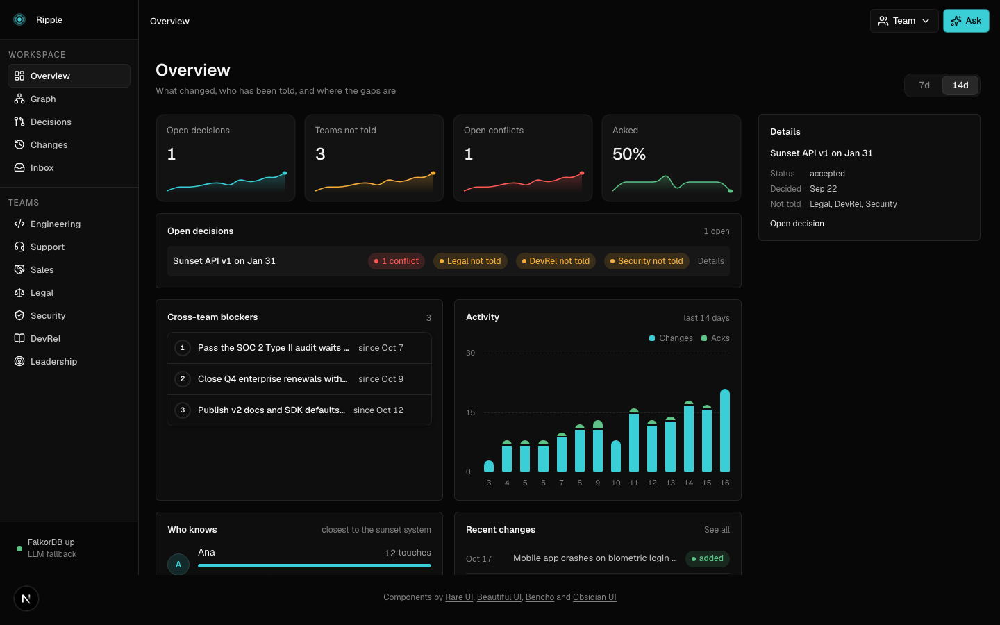
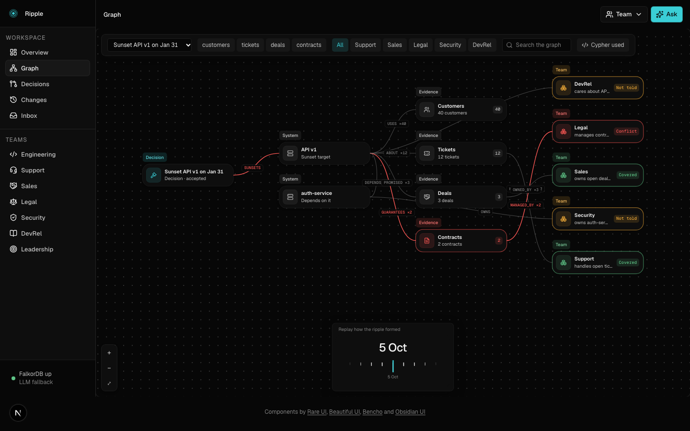
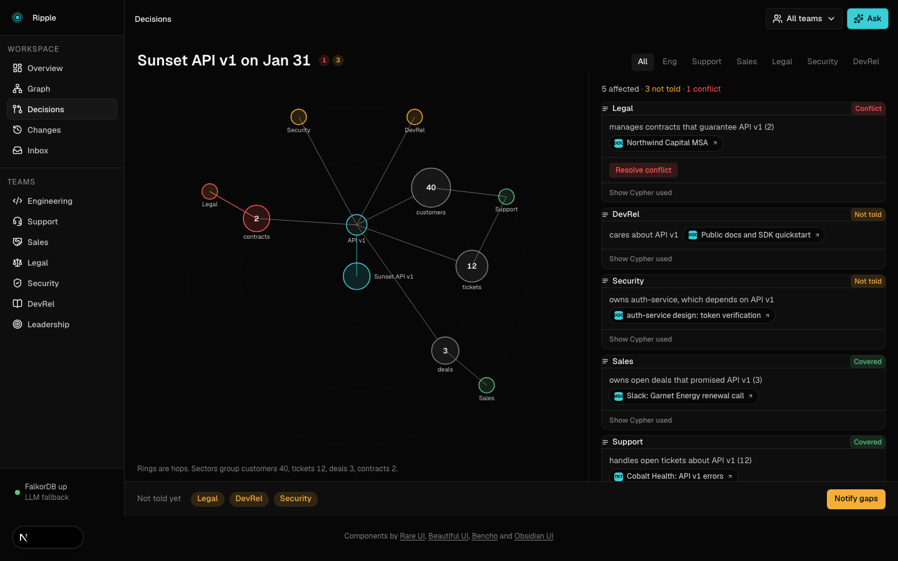
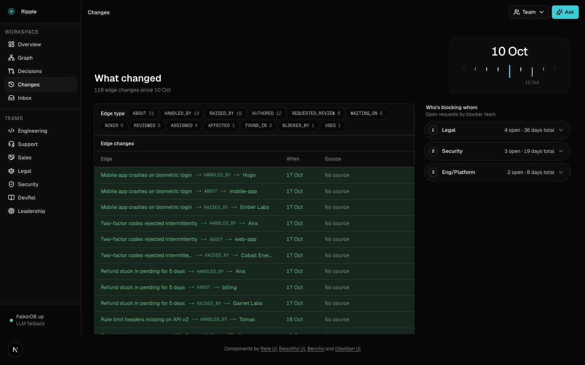
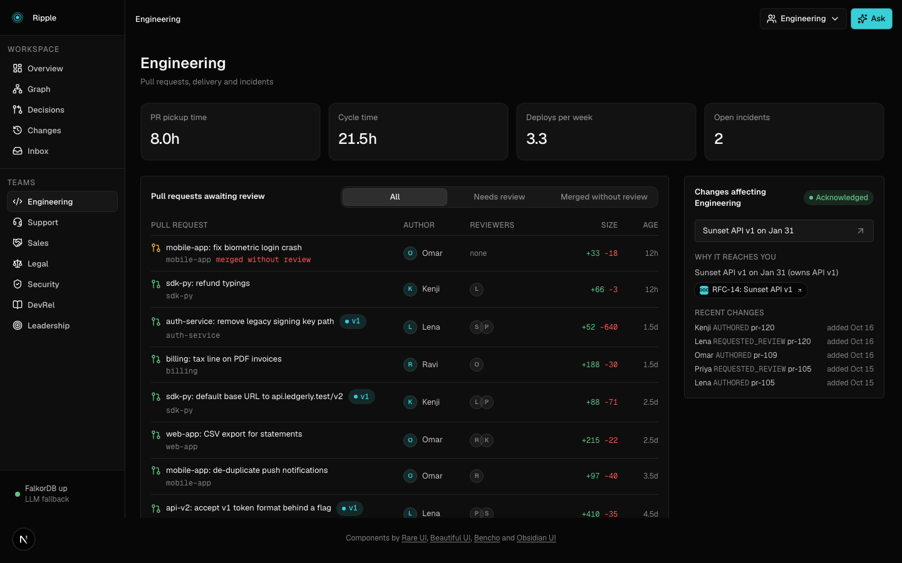
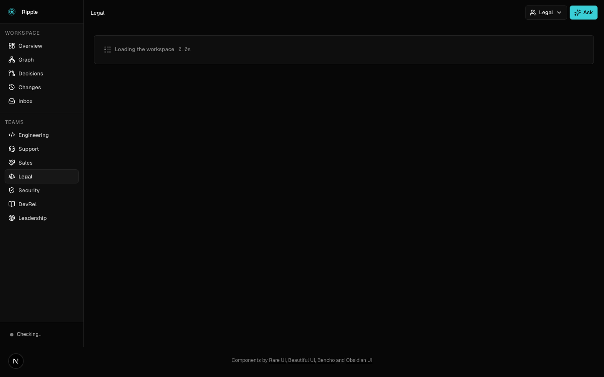
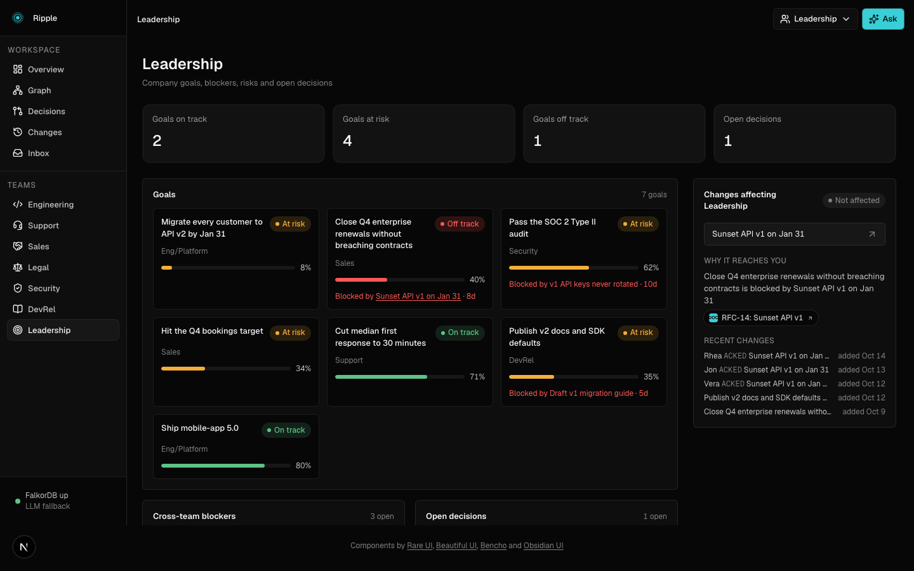
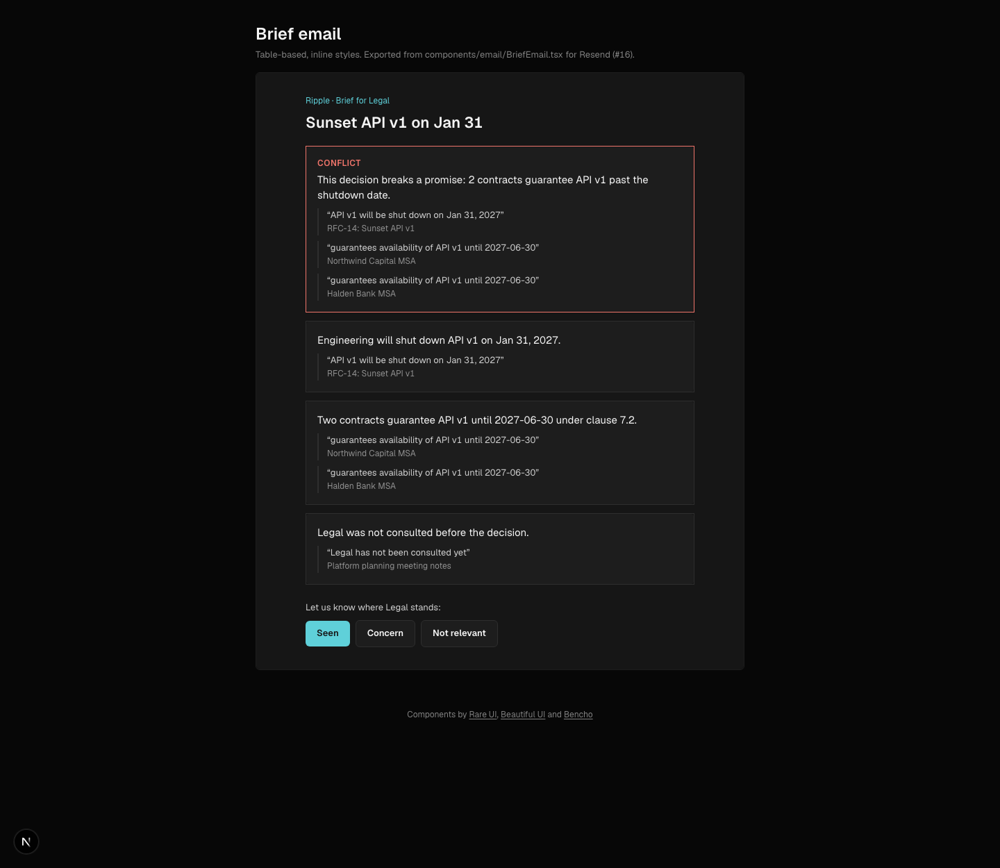
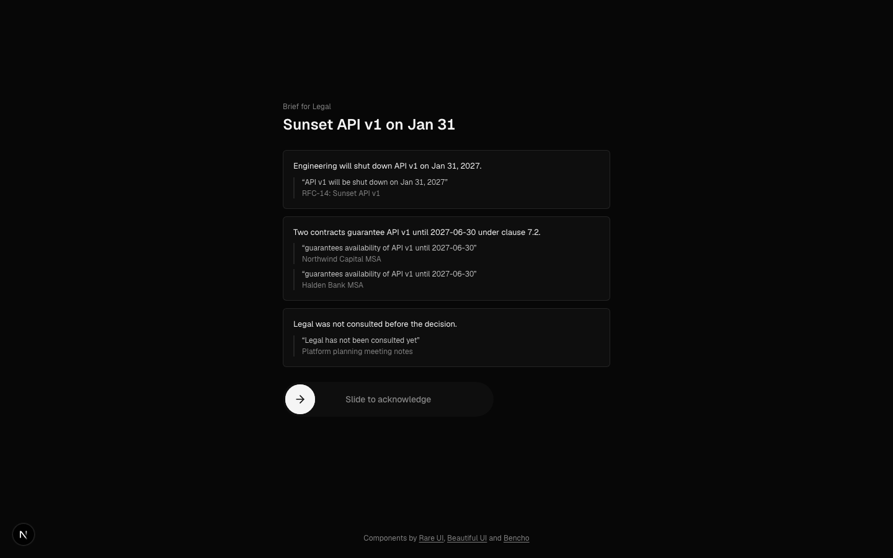
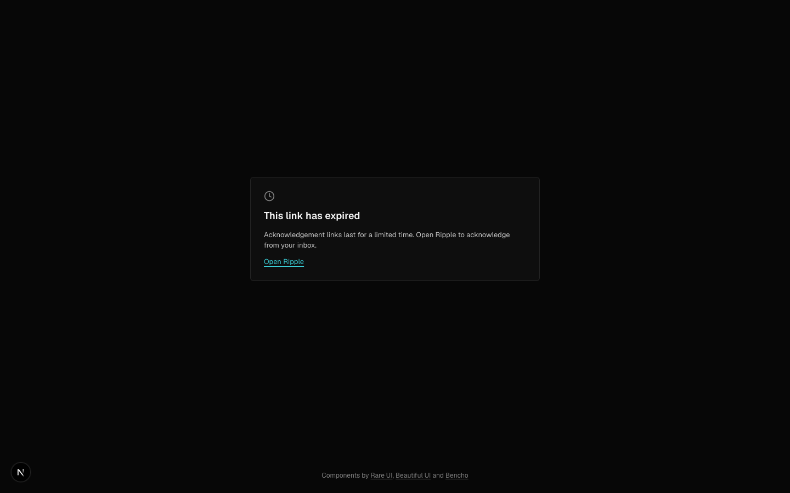

# Ripple

**A company brain on FalkorDB: change one decision and see every team, customer and contract it ripples into, with the receipts.**

- **Live:** https://ripple.vaibhav.quest (on Zerops)
- **Track:** Track 03: Company Brain, WeMakeDevs x FalkorDB Graph Hacks
- **Pitch:** before you ship a breaking change, ask the graph who it hits and who was never told.
- **Modelling:** Telling a team is an edge (INVOLVED_IN / ACKED), so a missing edge is the finding.

**Tools are not context.** Connecting an agent to Jira, Zendesk and the CRM gives it lookups, not an understanding of how a decision travels through a company. Ripple is that missing layer: one graph where a decision, the systems that depend on it, the customers, deals and contracts on those systems, and the teams that own them are connected, so "what does this touch, and who hasn't heard?" is a single traversal instead of a hundred API calls.

**Every answer is traceable.** Every edge carries the artifact it came from and a verbatim quote, every tool returns the Cypher it ran and the path it walked (`why_affected` shows the hops), and when nothing in the graph connects, Ripple says so instead of guessing.



Built for the WeMakeDevs x FalkorDB Graph Hacks, Track 03. Live demo data is a synthetic company, **Ledgerly**, that has just decided to sunset its API v1.

v2 is a dashboard product: `/overview`, a `/graph` explorer, `/decisions`, `/changes`, `/inbox`, and seven team workspaces under `/teams/<team>`, all reading one FalkorDB graph.

## Use Ripple from your agent

Ripple ships an MCP server: stateless Streamable HTTP at `/api/mcp` (12 tools) or stdio against a local FalkorDB.

```bash
# Claude Code, hosted demo
claude mcp add --transport http ripple https://ripple.vaibhav.quest/api/mcp
# local stdio: FalkorDB on :6379 with the seed loaded (this repo's .mcp.json already wires it)
claude mcp add ripple -e FALKORDB_HOST=localhost -e FALKORDB_PORT=6379 -- pnpm --silent mcp
```

Cursor and other clients (`mcp.json`):

```json
{ "mcpServers": { "ripple": { "url": "https://ripple.vaibhav.quest/api/mcp" } } }
```

**Skill.** [`skills/ripple-impact/SKILL.md`](skills/ripple-impact/SKILL.md) tells Claude when and how to use the tools for a deprecation or breaking change (find the decision, ripple, who wasn't told, contract conflicts, cited PR description, one brief per team, never acks without a yes). Install by copying the folder into `~/.claude/skills/` (all projects) or `.claude/skills/` (one project):

```bash
cp -r skills/ripple-impact ~/.claude/skills/
```

**Demo.** Ask "what does sunsetting API v1 (d-1) hit?" and raise `depth`; measured live, 20 to 50 ms per tool call:

| `ripple_impact` d-1 | Teams reached | Gap (never told) |
|---|---|---|
| depth 1 | devrel, legal, sales, support | legal, devrel |
| depth 3 (default) | + security | legal, security, devrel |
| depth 4 | + data | data, legal, security, devrel |

## Screens

| | |
|---|---|
|  `/overview`: KPIs, activity, blockers, team strip |  `/graph`: the ripple as a Flowchart, edge evidence on click |
|  `/decisions/d-1`: the ripple, the gap, the conflict |  `/changes`: dated edges added and ended |
|  `/teams/eng` |  `/teams/legal` |
|  `/teams/security` |  `/teams/leadership` |

Every team page has more screenshots in `docs/screens/v2-final-teams-*.png`.

## Team workspaces

Each team gets a page modelled on the tool it already uses. Ripple does not replace those tools; it adds the part none of them has, which is how the v1 sunset reaches that team, from the same graph. Each page ends with a "Changes affecting <team>" panel (`ripple-angle.cypher`): why the decision reaches the team, who knows, recent edges, with source quotes.

| Team | Feels like | What Ripple adds (the v1 sunset angle) |
|---|---|---|
| Eng (`/teams/eng`) | GitHub, LinearB | PRs and review load, plus which open PRs touch API v1 and who knows the system |
| Support (`/teams/support`) | Zendesk, Gainsight | Ticket queue and SLA, plus which tickets and customers depend on v1 |
| Sales (`/teams/sales`) | HubSpot | Pipeline and quarter goal, plus which open deals promised v1 and the ARR behind them |
| Legal (`/teams/legal`) | Ironclad | Contracts, clauses and renewals, plus the MSAs that guarantee v1 past the sunset date, with the quote |
| Security (`/teams/security`) | Vanta, Snyk | Controls by framework, findings, vendors, risk register, plus the controls and findings tied to v1 |
| DevRel (`/teams/devrel`) | Mintlify | Docs pages, failed searches, SDK adoption, plus the docs pages that still describe v1 |
| Leadership (`/teams/leadership`) | Asana Goals | Goals and risks, plus which goals are `BLOCKED_BY` the open decision |

## What it does

- **The ripple.** Pick a decision ("Sunset API v1 on Jan 31"). One Cypher query walks decision, systems, their dependents, then tickets, deals, contracts, customers and the teams that own or handle them.
- **The gap.** Teams the decision hits but never reached (no `INVOLVED_IN`, no `ACKED`). For the v1 sunset: Legal, Security and DevRel.
- **Conflicts.** A contract that guarantees a system past the date a decision sunsets it is flagged, with both quotes. Here: the Northwind and Halden MSAs promise v1 until Jun 2027, the sunset is Jan 31, 180,000 ARR at risk.
- **Sourced briefs.** Each team gets a short brief. Every claim cites an artifact and a verbatim quote; a claim whose citation is not in the ripple rows is dropped.
- **Acks.** Each brief carries a signed link. One click ("seen", "concern", "not relevant") writes an `ACKED` edge and the gap shrinks.

Ask it as a team (what hits me?) and inside a team (who knows this?):

- Who knows a system best (authored, reviewed, handled evidence, scored).
- Which team is the bottleneck (open `WAITING_ON` requests, grouped by blocker).
- What changed since a date (edges added or ended, dated).
- Why was a decision made (`SUPPORTED_BY` artifacts).
- Ask drawer: the model picks one of six query templates and fills parameters; it never writes Cypher.

## Why FalkorDB is load-bearing

- **Variable-length `DEPENDS_ON` traversal.** `ripple.cypher` walks decision, systems, dependents, then tickets, deals, contracts, customers and teams in one statement; `depth` is the hop bound (see the table above).
- **The missing-edge gap query.** `gap.cypher` finds teams the decision hits with no `INVOLVED_IN`/`ACKED` edge. The finding is an absence, which is natural in a graph and a set difference in application code elsewhere.
- **Temporal edges.** Every edge has `valid_from` / `valid_to` (epoch ints), so "what changed" and "what was true then" are plain `WHERE` clauses; moving the sunset date ends one edge and writes another.
- **`MERGE` write-back.** Conflicts, acks and tasks are written back with `MERGE`, so the gap shrinks when a team acks.
- **Full-text and vector index on `Artifact`.** `search.cypher` and `search-vector.cypher` find the decision's evidence, and the vector query hops to the systems each hit is `ABOUT` in the same statement.
- **Shortest path.** `why-affected.cypher` uses FalkorDB's `shortestPath` between a bound decision and a bound team to answer "why is this team affected?" with the chain of nodes and the quote on each edge (`why_affected` tool).
- **Read-only queries.** Every read (agent tools, MCP tools, page data) goes through `GRAPH.RO_QUERY` (`roQuery`), so FalkorDB itself rejects a write from a read path; only the MERGE/CREATE/SET templates use `query`.
- **Fixed Cypher tools.** The agent picks among a fixed set of Cypher-backed tools and fills parameters; it never writes Cypher.

## Architecture

One Next.js 16 app (UI plus route handlers) and one FalkorDB. No other services.

```
 browser ──► Next.js app (React UI, /api/* route handlers)
                │  lib/graph/queries.ts  (typed wrappers over *.cypher)
                │  lib/teams             (one compute per team workspace)
                │  lib/agent             (tool-calling loop, 6 templates)
                │  lib/briefs.ts         (claims + citation check)
                │  lib/ingest            (extract -> quote check -> cache; embed)
                ▼
            FalkorDB 6.0.2  (graph per company key: nodes, dated edges,
                             full-text index, 384-d vector index)
```

- **Screens:** `app/(app)/` routes `overview`, `graph`, `decisions`, `changes`, `inbox`, `teams/[team]`. The `/graph` view uses the Beautiful UI Flowchart fed by `graph-view.cypher`.
- **LLM: AI SDK, bring your own key** (Anthropic, OpenAI, Google, OpenRouter, OpenAI-compatible, Ollama). No key: the app runs on deterministic query wrappers and committed caches.
- **Embeddings are local**: MiniLM-L6-v2 (384-d) via `@huggingface/transformers`, cached by content hash in `lib/ingest/cache/embed`.

## Quickstart

Runs with no API key.

```bash
# FalkorDB 6.0.2 (Apple container)
container run -d --name falkor -p 6379:6379 -p 3000:3000 falkordb/falkordb:6.0.2
# or Docker
docker run -d --name falkor -p 6379:6379 -p 3000:3000 falkordb/falkordb:6.0.2

cp .env.example .env     # defaults point at localhost:6379; LLM_API_KEY may stay empty
pnpm i
pnpm seed                # builds graph `demo` from the committed caches
pnpm dev                 # http://localhost:3000 (map the FalkorDB browser to another port if 3000 is taken)
```

Set `LLM_PROVIDER` / `LLM_API_KEY` in `.env` to switch on the model-backed Ask drawer and brief rewording. Other scripts: `pnpm extract`, `pnpm embed`, `pnpm test`, `pnpm eval`.

## Graph data model

**Nodes** (label: properties). Artifacts carry two labels, `Artifact` plus their kind.

| Label | Properties |
|---|---|
| Team | id, name |
| Person | id, name, title, email, teamId, active |
| System | id, name, kind (api/service/repo), status, version, successor |
| Customer | id, name, arr, tier, region, monthlyCalls |
| Deal | id, name, stage, amount, closeDate, customerId |
| Contract | id, name, endsAt, customerId |
| Decision | id, title, status, decidedAt |
| Incident, Task | id plus title/status/timestamps |
| Clause | id, contractId, number, title, text, risk, dueAt, v1Related |
| Framework | id, name |
| Control | id, frameworkId, name, status (passing/failing), auditBlocking, ownerId, v1Related |
| Vendor | id, name, riskTier, assessmentStatus, nextReview |
| Finding | id, title, severity, slaDueAt, systemId, status, ownerId, v1Related |
| Risk | id, title, likelihood, impact, status, ownerId, teamId, v1Related |
| Page | id, path, views30d, feedbackUp, feedbackDown, v1Related |
| DocsStats | id, failedSearchesJson, sdkAdoptionJson |
| Goal | id, title, ownerTeamId, progress, status, target, current |
| Artifact + Doc / Ticket / Message / PR | id, kind, title, text, ts, uri, author, emb (384-d vector), status (tickets); v2 adds ticket priority/SLA fields and PR repo/state/reviewer fields |
| Conflict | id, kind, severity, status, decisionId, contractIds, detectedAt, sources (JSON) |

**Edges**, grouped:

- Org: `MEMBER_OF`, `OWNS`, `CARES_ABOUT`, `MAINTAINS`, `ASSIGNED`, `CONTACT`
- Work evidence: `AUTHORED`, `REVIEWED`, `ABOUT`, `RAISED_BY`, `HANDLED_BY`, `ATTENDED`
- System graph: `DEPENDS_ON`, `USES`, `AFFECTED`, `CAUSED_BY`
- Commercial: `PROMISED`, `GUARANTEES`, `PARTY_TO`, `OWNED_BY`, `MANAGED_BY`
- Decisions: `SUNSETS`, `SUPPORTED_BY`, `SUPERSEDES`, `INVOLVED_IN`, `ACKED`, `BETWEEN`
- Process: `WAITING_ON`, `NOTIFIES`
- v2 workspaces: `HAS_CLAUSE` (Contract to Clause), `COVERS` (Control to Framework), `BLOCKED_BY` (Goal to a Decision, Finding or Task), `FOUND_IN` (Finding to System), `REQUESTED_REVIEW` (reviewer to PR)

**Rules**

- Every edge has `valid_from`, `valid_to` (absent/null = current) and `observed_at`. Ended edges are kept, not deleted.
- Extracted edges carry `src` (artifact id) and `quote`. A quote must be a verbatim substring of the artifact text; edges that fail the check are dropped (`quoteCheck` in `lib/ingest/extract.ts`).
- ACL fields: artifacts record `author`, and the ack link is a signed token scoped to one team and one decision. Graphs are separated per company key.
- All dates are epoch-second integers (`$now` is passed in), so no date arithmetic is needed in Cypher.

## Cypher we run

Every template in `lib/graph/queries/`, verbatim (this section is generated from the files). The agent only chooses a template and fills parameters.

### `artifact-text.cypher`

Text of artifacts by id, to build verbatim citation quotes.

```cypher
// Text of artifacts by id, to build verbatim citation quotes.
MATCH (a:Artifact) WHERE a.id IN $ids
RETURN a.id AS id, a.text AS text
```

### `bottleneck.cypher`

Open WAITING_ON between teams, grouped by the team that is blocking.

```cypher
// Open WAITING_ON between teams, grouped by the team that is blocking.
MATCH (w:Team)-[r:WAITING_ON]->(b:Team)
WHERE r.valid_to IS NULL
RETURN b.id AS blockerTeamId, count(r) AS openRequests, sum($now - r.valid_from) AS totalWaitSecs,
  min(r.valid_from) AS oldestSince, collect(DISTINCT w.id) AS waitingTeamIds
ORDER BY totalWaitSecs DESC
```

### `change-sunset.cypher`

End the current SUNSETS edge of a decision and write its replacement.

```cypher
// End the current SUNSETS edge of a decision and write its replacement.
MATCH (d:Decision {id: $id})-[s:SUNSETS]->(x:System)
WHERE s.valid_to IS NULL
SET s.valid_to = $now
WITH d, x
CREATE (d)-[n:SUNSETS {on: $newOn, valid_from: $now, observed_at: $now}]->(x)
RETURN x.id AS systemId
```

### `conflicts-detect.cypher`

A contract guarantees a system past the date the decision sunsets it; both edges current.

```cypher
// A contract guarantees a system past the date the decision sunsets it; both edges current.
MATCH (d:Decision {id: $id})-[s:SUNSETS]->(sys:System)<-[g:GUARANTEES]-(c:Contract)
WHERE s.valid_to IS NULL AND g.valid_to IS NULL AND g.until > s.on
RETURN sys.id AS systemId, collect(c.id) AS contractIds,
  collect({artifactId: g.src, quote: g.quote}) AS guaranteeSources,
  head(collect(s.src)) AS sunsetSrc, head(collect(s.quote)) AS sunsetQuote
```

### `conflicts-list.cypher`

Conflict nodes for a decision.

```cypher
// Conflict nodes for a decision.
MATCH (k:Conflict {decisionId: $id})
RETURN k.id AS id, k.kind AS kind, k.severity AS severity, k.status AS status,
  k.decisionId AS decisionId, k.contractIds AS contractIds, k.detectedAt AS detectedAt, k.sources AS sources
ORDER BY k.id
```

### `conflicts-merge.cypher`

Idempotent: one Conflict per (decision, system), open, BETWEEN the decision and each contract.

```cypher
// Idempotent: one Conflict per (decision, system), open, BETWEEN the decision and each contract.
MERGE (k:Conflict {id: $cid})
ON CREATE SET k.detectedAt = $now
SET k.kind = 'sunset_vs_guarantee', k.severity = 'high', k.status = 'open',
    k.decisionId = $id, k.contractIds = $contractIds, k.sources = $sources
WITH k
MATCH (d:Decision {id: $id})
MERGE (k)-[b:BETWEEN]->(d)
ON CREATE SET b.valid_from = $now, b.observed_at = $now
WITH k
UNWIND $contractIds AS cid
MATCH (c:Contract {id: cid})
MERGE (k)-[b2:BETWEEN]->(c)
ON CREATE SET b2.valid_from = $now, b2.observed_at = $now
RETURN count(k) AS n
```

### `conflicts-resolve.cypher`

Open conflicts for this decision that were not re-detected are no longer true.

```cypher
// Open conflicts for this decision that were not re-detected are no longer true.
MATCH (k:Conflict {decisionId: $id, status: 'open'})
WHERE NOT k.id IN $keep
SET k.status = 'resolved'
RETURN count(k) AS n
```

### `create-tasks.cypher`

Demo graph only: one open Task per gap team, linked with NOTIFIES.

```cypher
// Demo graph only: one open Task per gap team, linked with NOTIFIES.
UNWIND $rows AS row
MATCH (t:Team {id: row.teamId})
MERGE (k:Task {id: row.id})
SET k.title = row.title, k.teamId = row.teamId, k.status = 'open', k.createdAt = $now
MERGE (k)-[n:NOTIFIES]->(t)
SET n.valid_from = $now, n.valid_to = null
RETURN k.id AS id, k.title AS title, t.id AS teamId
```

### `decision.cypher`

The decision node plus the evidence of its current SUNSETS edge, for assembling a RippleResult.

```cypher
// The decision node plus the evidence of its current SUNSETS edge, for assembling a RippleResult.
// One row per current SUNSETS edge (the wrapper takes the first).
MATCH (d:Decision {id: $id})
OPTIONAL MATCH (d)-[sn:SUNSETS]->(:System) WHERE sn.valid_to IS NULL
RETURN d.id AS id, d.title AS title, d.status AS status, d.decidedAt AS decidedAt,
  sn.src AS src, sn.quote AS quote
```

### `decisions.cypher`

Every decision, oldest first.

```cypher
// Every decision, oldest first.
MATCH (d:Decision)
RETURN d.id AS id, d.title AS title, d.status AS status, d.decidedAt AS decidedAt
ORDER BY d.decidedAt
```

### `diff.cypher`

Edges added or ended after $since (conflict BETWEEN edges are detection bookkeeping, not changes).

```cypher
// Edges added or ended after $since (conflict BETWEEN edges are detection bookkeeping, not changes).
MATCH (a)-[r]->(b)
WHERE (r.valid_from > $since OR r.valid_to > $since) AND type(r) <> 'BETWEEN'
RETURN a.id AS from, b.id AS to, type(r) AS type, r.valid_from AS validFrom, r.valid_to AS validTo,
  r.src AS src, r.quote AS quote
```

### `gap.cypher`

Per affected team: was it involved in, or did it acknowledge, the decision?

```cypher
// Per affected team: was it involved in, or did it acknowledge, the decision?
MATCH (t:Team) WHERE t.id IN $affected
OPTIONAL MATCH (t)-[i:INVOLVED_IN]->(:Decision {id: $id})
OPTIONAL MATCH (t)-[a:ACKED]->(:Decision {id: $id})
RETURN t.id AS team, t.name AS name, count(i) > 0 AS involved, count(a) > 0 AS acked
```

### `graph-view.cypher`

Edge evidence for the /graph flowchart: every current edge into the systems a decision's sunset reaches,

```cypher
// Edge evidence for the /graph flowchart: every current edge into the systems a decision's sunset reaches,
// plus the SUNSETS edge and the DEPENDS_ON chain. Row: from, to, type, validFrom, src, quote.
MATCH (d:Decision {id: $id})-[sn:SUNSETS]->(s:System)
WHERE sn.valid_to IS NULL
MATCH p = (s)<-[:DEPENDS_ON*0..2]-(x:System)
WHERE ALL(e IN relationships(p) WHERE e.valid_to IS NULL)
WITH DISTINCT x
MATCH (a)-[r:ABOUT|PROMISED|GUARANTEES|USES|OWNS|CARES_ABOUT]->(x)
WHERE r.valid_to IS NULL
RETURN a.id AS from, x.id AS to, type(r) AS type, r.valid_from AS validFrom, r.src AS src, r.quote AS quote
UNION ALL
MATCH (d:Decision {id: $id})-[sn:SUNSETS]->(s:System)
WHERE sn.valid_to IS NULL
RETURN d.id AS from, s.id AS to, 'SUNSETS' AS type, sn.valid_from AS validFrom, sn.src AS src, sn.quote AS quote
UNION ALL
MATCH (d:Decision {id: $id})-[sn:SUNSETS]->(s:System)
WHERE sn.valid_to IS NULL
MATCH p = (s)<-[:DEPENDS_ON*0..2]-(x:System)
WHERE ALL(e IN relationships(p) WHERE e.valid_to IS NULL)
WITH DISTINCT x
MATCH (x)-[r:DEPENDS_ON]->(y:System)
WHERE r.valid_to IS NULL
RETURN x.id AS from, y.id AS to, 'DEPENDS_ON' AS type, r.valid_from AS validFrom, r.src AS src, r.quote AS quote
```

### `inbox-person.cypher`

A person's team, and the decisions that sunset a system their team owns.

```cypher
// A person's team, and the decisions that sunset a system their team owns.
MATCH (p:Person {id: $id})-[:MEMBER_OF]->(t:Team)
OPTIONAL MATCH (t)-[:OWNS]->(:System)<-[s:SUNSETS]-(d:Decision) WHERE s.valid_to IS NULL
RETURN t.id AS team, collect(DISTINCT d.id) AS decisions
```

### `inbox-reviews.cypher`

Tasks in review assigned to a person.

```cypher
// Tasks in review assigned to a person.
MATCH (k:Task {status: 'in_review'})-[a:ASSIGNED]->(:Person {id: $id})
RETURN k.id AS id, k.title AS title, k.createdAt AS at, a.by AS fromId
ORDER BY at DESC
```

### `inbox-waiting.cypher`

Teams with an open request waiting on this team.

```cypher
// Teams with an open request waiting on this team.
MATCH (w:Team)-[r:WAITING_ON]->(:Team {id: $team})
WHERE r.valid_to IS NULL
RETURN w.id AS id, w.name AS name, r.valid_from AS at
ORDER BY at
```

### `names.cypher`

id -> display name for every node with a name or title (teams, people, systems, customers, decisions, deals, contracts, artifacts, tasks, findings).

```cypher
// id -> display name for every node with a name or title (teams, people, systems, customers, decisions, deals, contracts, artifacts, tasks, findings).
MATCH (n)
WHERE n.name IS NOT NULL OR n.title IS NOT NULL
RETURN n.id AS id, coalesce(n.name, n.title) AS name
```

### `overview-activity.cypher`

Edges added since $since (type + timestamp); the wrapper buckets them per day into changes and acks.

```cypher
// Edges added since $since (type + timestamp); the wrapper buckets them per day into changes and acks.
MATCH ()-[r]->()
WHERE r.valid_from >= $since AND type(r) <> 'BETWEEN'
RETURN type(r) AS type, r.valid_from AS at
```

### `overview-blockers.cypher`

Open BLOCKED_BY edges: a goal that cannot move until a decision, finding or task is resolved.

```cypher
// Open BLOCKED_BY edges: a goal that cannot move until a decision, finding or task is resolved.
MATCH (g)-[b:BLOCKED_BY]->(x) WHERE b.valid_to IS NULL
RETURN g.id AS fromId, x.id AS toId, b.valid_from AS since
ORDER BY since
```

### `overview-teams.cypher`

Head count per team for the overview strip.

```cypher
// Head count per team for the overview strip.
MATCH (t:Team)
OPTIONAL MATCH (p:Person {teamId: t.id})
RETURN t.id AS id, t.name AS name, count(p) AS people
ORDER BY id
```

### `people.cypher`

Everyone in the directory.

```cypher
// Everyone in the directory.
MATCH (p:Person)
RETURN p.id AS id, p.name AS name, p.title AS title, p.email AS email, p.teamId AS teamId, p.active AS active
ORDER BY p.id
```

### `ripple-angle.cypher`

What the decision means for one team ($team, $decision, $since). Each branch returns kind + rows.

```cypher
// What the decision means for one team ($team, $decision, $since). Each branch returns kind + rows.
// changes: recent edges that touch the team, its people, or things it owns/manages/handles (newest 8)
MATCH (a)-[r]->(b)
WHERE r.valid_from > $since AND type(r) <> 'BETWEEN'
  AND (a.id = $team OR b.id = $team OR a.teamId = $team OR b.teamId = $team OR a.ownerTeamId = $team
    OR (a)-[:MANAGED_BY]->(:Team {id: $team}) OR (a)-[:OWNED_BY]->(:Team {id: $team})
    OR (a)-[:HANDLED_BY]->(:Person {teamId: $team}) OR (:Team {id: $team})-[:OWNS]->(a))
WITH a, r, b ORDER BY r.valid_from DESC LIMIT 8
RETURN 'changes' AS kind, collect({from: a.id, to: b.id, type: type(r), validFrom: r.valid_from, validTo: r.valid_to,
  src: r.src, quote: r.quote}) AS rows
UNION ALL
// gap: is the team hit by what the decision sunsets, and did it take part or acknowledge?
MATCH (t:Team {id: $team})
OPTIONAL MATCH (d:Decision {id: $decision})-[:SUNSETS]->(s:System)
OPTIONAL MATCH (t)-[a:AFFECTED|OWNS|CARES_ABOUT]->(s)
OPTIONAL MATCH (t)-[i:INVOLVED_IN]->(d)
OPTIONAL MATCH (t)-[k:ACKED]->(d)
WITH count(a) > 0 AS affected, count(i) > 0 AS involved, count(k) > 0 AS acked
RETURN 'gap' AS kind, [{affected: affected, involved: involved, acked: acked}] AS rows
UNION ALL
// facts: one sourced line per way the team is tied to the sunset (the wrapper keeps the first 3)
MATCH (t:Team {id: $team})-[r:OWNS|CARES_ABOUT]->(s:System) WHERE r.valid_to IS NULL AND r.src IS NOT NULL
WITH t, r, s LIMIT 1
RETURN 'facts' AS kind, collect({text: CASE type(r) WHEN 'OWNS' THEN 'Owns ' ELSE 'Cares about ' END + s.name, src: r.src, quote: r.quote}) AS rows
UNION ALL
MATCH (c:Contract)-[:MANAGED_BY]->(:Team {id: $team})
MATCH (c)-[r:GUARANTEES]->(s:System) WHERE r.valid_to IS NULL AND r.src IS NOT NULL
WITH c, r, s ORDER BY c.id LIMIT 1
RETURN 'facts' AS kind, collect({text: c.name + ' guarantees ' + s.name + ' past the sunset', src: r.src, quote: r.quote}) AS rows
UNION ALL
MATCH (d:Deal)-[:OWNED_BY]->(:Team {id: $team})
MATCH (d)-[r:PROMISED]->(s:System) WHERE r.valid_to IS NULL AND r.src IS NOT NULL AND d.stage <> 'closed_lost'
WITH d, r, s ORDER BY d.id LIMIT 1
RETURN 'facts' AS kind, collect({text: d.name + ' was promised ' + s.name + ' through 2027', src: r.src, quote: r.quote}) AS rows
UNION ALL
MATCH (a:Ticket {status: 'open'})-[r:ABOUT]->(s:System {id: 'api-v1'}) WHERE r.valid_to IS NULL AND r.src IS NOT NULL
MATCH (a)-[:HANDLED_BY]->(p:Person {teamId: $team})
WITH a, r, s ORDER BY a.id LIMIT 1
RETURN 'facts' AS kind, collect({text: 'Open ticket: ' + a.title, src: r.src, quote: r.quote}) AS rows
UNION ALL
MATCH (t:Team {id: $team})-[:OWNS]->(s:System)<-[r:SUNSETS]-(d:Decision {id: $decision}) WHERE r.valid_to IS NULL AND r.src IS NOT NULL
WITH d, r, s LIMIT 1
RETURN 'facts' AS kind, collect({text: d.title + ' (owns ' + s.name + ')', src: r.src, quote: r.quote}) AS rows
UNION ALL
MATCH (g:Goal)-[r:BLOCKED_BY]->(d:Decision {id: $decision}) WHERE $team = 'leadership' AND r.src IS NOT NULL
WITH g, r, d ORDER BY g.id LIMIT 1
RETURN 'facts' AS kind, collect({text: g.title + ' is blocked by ' + d.title, src: r.src, quote: r.quote}) AS rows
```

### `ripple.cypher`

Everything a decision touches: SUNSETS -> system <- DEPENDS_ON*0..2 dependents, then

```cypher
// Everything a decision touches: SUNSETS -> system <- DEPENDS_ON*0..2 dependents, then
// entities (tickets, deals, contracts, customers) and the teams that own/handle/care.
// Row: kind, ref, label, sys, hop, rel, team, reason, src, quote, amount. UNION ALL branches.
MATCH (d:Decision {id: $id})-[sn:SUNSETS]->(s:System)
WHERE sn.valid_to IS NULL
MATCH p = (s)<-[:DEPENDS_ON*0..2]-(x:System)
WHERE ALL(e IN relationships(p) WHERE e.valid_to IS NULL)
RETURN 'system' AS kind, x.id AS ref, x.name AS label,
  CASE WHEN length(p) = 0 THEN null ELSE nodes(p)[length(p) - 1].id END AS sys,
  length(p) + 1 AS hop, 'DEPENDS_ON' AS rel, null AS team, null AS reason, null AS src, null AS quote, 0 AS amount
UNION ALL
MATCH (d:Decision {id: $id})-[sn:SUNSETS]->(s:System)
WHERE sn.valid_to IS NULL
MATCH p = (s)<-[:DEPENDS_ON*0..2]-(x:System)
WHERE ALL(e IN relationships(p) WHERE e.valid_to IS NULL)
MATCH (a:Ticket {status: 'open'})-[r:ABOUT]->(x) WHERE r.valid_to IS NULL
RETURN 'ticket' AS kind, a.id AS ref, a.title AS label, x.id AS sys, length(p) + 2 AS hop, 'ABOUT' AS rel,
  null AS team, null AS reason, r.src AS src, r.quote AS quote, 0 AS amount
UNION ALL
MATCH (d:Decision {id: $id})-[sn:SUNSETS]->(s:System)
WHERE sn.valid_to IS NULL
MATCH p = (s)<-[:DEPENDS_ON*0..2]-(x:System)
WHERE ALL(e IN relationships(p) WHERE e.valid_to IS NULL)
MATCH (dl:Deal)-[r:PROMISED]->(x) WHERE r.valid_to IS NULL AND dl.stage <> 'closed_lost'
RETURN 'deal' AS kind, dl.id AS ref, dl.name AS label, x.id AS sys, length(p) + 2 AS hop, 'PROMISED' AS rel,
  null AS team, null AS reason, r.src AS src, r.quote AS quote, dl.amount AS amount
UNION ALL
MATCH (d:Decision {id: $id})-[sn:SUNSETS]->(s:System)
WHERE sn.valid_to IS NULL
MATCH p = (s)<-[:DEPENDS_ON*0..2]-(x:System)
WHERE ALL(e IN relationships(p) WHERE e.valid_to IS NULL)
MATCH (c:Contract)-[r:GUARANTEES]->(x) WHERE r.valid_to IS NULL
MATCH (c)-[:PARTY_TO]->(cu:Customer)
RETURN 'contract' AS kind, c.id AS ref, c.name AS label, x.id AS sys, length(p) + 2 AS hop, 'GUARANTEES' AS rel,
  null AS team, null AS reason, r.src AS src, r.quote AS quote, cu.arr AS amount
UNION ALL
MATCH (d:Decision {id: $id})-[sn:SUNSETS]->(s:System)
WHERE sn.valid_to IS NULL
MATCH p = (s)<-[:DEPENDS_ON*0..2]-(x:System)
WHERE ALL(e IN relationships(p) WHERE e.valid_to IS NULL)
MATCH (cu:Customer)-[r:USES]->(x) WHERE r.valid_to IS NULL AND r.last_seen >= $now - 120 * 86400
RETURN 'customer' AS kind, cu.id AS ref, cu.name AS label, x.id AS sys, length(p) + 2 AS hop, 'USES' AS rel,
  null AS team, null AS reason, r.src AS src, r.quote AS quote, cu.arr AS amount
UNION ALL
MATCH (d:Decision {id: $id})-[sn:SUNSETS]->(s:System)
WHERE sn.valid_to IS NULL
MATCH p = (s)<-[:DEPENDS_ON*0..2]-(x:System)
WHERE ALL(e IN relationships(p) WHERE e.valid_to IS NULL)
MATCH (t:Team)-[r:OWNS]->(x) WHERE r.valid_to IS NULL AND NOT (t)-[:OWNS]->(s)
RETURN 'team' AS kind, x.id AS ref, x.name AS label, x.id AS sys, 0 AS hop, 'OWNS' AS rel,
  t.id AS team, 'owns ' + x.name + ', which depends on ' + s.name AS reason, r.src AS src, r.quote AS quote, 0 AS amount
UNION ALL
MATCH (d:Decision {id: $id})-[sn:SUNSETS]->(s:System)
WHERE sn.valid_to IS NULL
MATCH p = (s)<-[:DEPENDS_ON*0..2]-(x:System)
WHERE ALL(e IN relationships(p) WHERE e.valid_to IS NULL)
MATCH (t:Team)-[r:CARES_ABOUT]->(x) WHERE r.valid_to IS NULL
RETURN 'team' AS kind, x.id AS ref, x.name AS label, x.id AS sys, 0 AS hop, 'CARES_ABOUT' AS rel,
  t.id AS team, 'cares about ' + x.name AS reason, r.src AS src, r.quote AS quote, 0 AS amount
UNION ALL
MATCH (d:Decision {id: $id})-[sn:SUNSETS]->(s:System)
WHERE sn.valid_to IS NULL
MATCH p = (s)<-[:DEPENDS_ON*0..2]-(x:System)
WHERE ALL(e IN relationships(p) WHERE e.valid_to IS NULL)
MATCH (a:Ticket {status: 'open'})-[r:ABOUT]->(x) WHERE r.valid_to IS NULL
MATCH (a)-[:HANDLED_BY]->(:Person)-[:MEMBER_OF]->(t:Team)
RETURN 'team' AS kind, a.id AS ref, a.title AS label, x.id AS sys, 0 AS hop, 'HANDLED_BY' AS rel,
  t.id AS team, 'handles open tickets about ' + x.name AS reason, r.src AS src, r.quote AS quote, 0 AS amount
UNION ALL
MATCH (d:Decision {id: $id})-[sn:SUNSETS]->(s:System)
WHERE sn.valid_to IS NULL
MATCH p = (s)<-[:DEPENDS_ON*0..2]-(x:System)
WHERE ALL(e IN relationships(p) WHERE e.valid_to IS NULL)
MATCH (a:Ticket {status: 'open'})-[r:ABOUT]->(x) WHERE r.valid_to IS NULL
MATCH (a)-[:HANDLED_BY]->(t:Team)
RETURN 'team' AS kind, a.id AS ref, a.title AS label, x.id AS sys, 0 AS hop, 'HANDLED_BY' AS rel,
  t.id AS team, 'handles open tickets about ' + x.name AS reason, r.src AS src, r.quote AS quote, 0 AS amount
UNION ALL
MATCH (d:Decision {id: $id})-[sn:SUNSETS]->(s:System)
WHERE sn.valid_to IS NULL
MATCH p = (s)<-[:DEPENDS_ON*0..2]-(x:System)
WHERE ALL(e IN relationships(p) WHERE e.valid_to IS NULL)
MATCH (dl:Deal)-[r:PROMISED]->(x) WHERE r.valid_to IS NULL AND dl.stage <> 'closed_lost'
MATCH (dl)-[:OWNED_BY]->(t:Team)
RETURN 'team' AS kind, dl.id AS ref, dl.name AS label, x.id AS sys, 0 AS hop, 'OWNED_BY' AS rel,
  t.id AS team, 'owns open deals that promised ' + x.name AS reason, r.src AS src, r.quote AS quote, 0 AS amount
UNION ALL
MATCH (d:Decision {id: $id})-[sn:SUNSETS]->(s:System)
WHERE sn.valid_to IS NULL
MATCH p = (s)<-[:DEPENDS_ON*0..2]-(x:System)
WHERE ALL(e IN relationships(p) WHERE e.valid_to IS NULL)
MATCH (c:Contract)-[r:GUARANTEES]->(x) WHERE r.valid_to IS NULL
MATCH (c)-[:MANAGED_BY]->(t:Team)
RETURN 'team' AS kind, c.id AS ref, c.name AS label, x.id AS sys, 0 AS hop, 'MANAGED_BY' AS rel,
  t.id AS team, 'manages contracts that guarantee ' + x.name AS reason, r.src AS src, r.quote AS quote, 0 AS amount
```

### `search-vector.cypher`

Hybrid: nearest Artifacts by embedding, then hop to the systems they are ABOUT.

```cypher
// Hybrid: nearest Artifacts by embedding, then hop to the systems they are ABOUT.
CALL db.idx.vector.queryNodes('Artifact', 'emb', $k, vecf32($vec)) YIELD node, score
OPTIONAL MATCH (node)-[:ABOUT]->(s:System)
RETURN node.id AS id, node.kind AS kind, node.title AS title, score, collect(s.id) AS systemIds
ORDER BY score
```

### `search.cypher`

Full-text over Artifact.text.

```cypher
// Full-text over Artifact.text.
CALL db.idx.fulltext.queryNodes('Artifact', $text) YIELD node, score
RETURN node.id AS id, node.kind AS kind, node.title AS title, score
ORDER BY score DESC LIMIT 10
```

### `source.cypher`

One artifact (doc, ticket, message or PR) by id.

```cypher
// One artifact (doc, ticket, message or PR) by id.
MATCH (a:Artifact {id: $id})
RETURN a.id AS id, a.kind AS kind, a.docKind AS docKind, a.status AS status, a.title AS title,
  a.text AS text, a.ts AS ts, a.uri AS uri, a.author AS authorId
```

### `teams-devrel.cypher`

DevRel dashboard rows: docs pages, docs stats (JSON strings), SDK repos, docs tasks, the team. Param: $team.

```cypher
// DevRel dashboard rows: docs pages, docs stats (JSON strings), SDK repos, docs tasks, the team. Param: $team.
MATCH (g:Page)
RETURN 'pages' AS kind, collect({id: g.id, path: g.path, views30d: g.views30d, feedbackUp: g.feedbackUp,
  feedbackDown: g.feedbackDown, v1Related: coalesce(g.v1Related, false)}) AS rows
UNION ALL
MATCH (d:DocsStats)
RETURN 'docsStats' AS kind, collect({id: d.id, failedSearches: d.failedSearchesJson, sdkAdoption: d.sdkAdoptionJson}) AS rows
UNION ALL
MATCH (s:System) WHERE s.id STARTS WITH 'sdk-'
RETURN 'sdks' AS kind, collect({id: s.id, name: s.name, kind: s.kind, status: s.status, version: s.version,
  successor: s.successor, onCallPersonId: s.onCallPersonId}) AS rows
UNION ALL
MATCH (k:Task {teamId: $team})
RETURN 'tasks' AS kind, collect({id: k.id, title: k.title, teamId: k.teamId, assigneeId: k.assigneeId, status: k.status,
  createdAt: k.createdAt, kind: k.kind, dueAt: k.dueAt}) AS rows
UNION ALL
MATCH (p:Person {teamId: $team})
RETURN 'people' AS kind, collect({id: p.id, name: p.name, title: p.title, email: p.email, teamId: p.teamId, active: p.active}) AS rows
```

### `teams-eng.cypher`

Eng dashboard rows. Every branch returns one row: kind + rows (a list of maps). Param: $team.

```cypher
// Eng dashboard rows. Every branch returns one row: kind + rows (a list of maps). Param: $team.
MATCH (p:PR) WHERE p.state IS NOT NULL
RETURN 'prs' AS kind, collect({id: p.id, title: p.title, repo: p.repo, authorId: p.author, state: p.state,
  additions: p.additions, deletions: p.deletions, createdAt: p.createdAt, firstReviewAt: p.firstReviewAt,
  mergedAt: p.mergedAt, reviewerIds: p.reviewerIds, v1Related: coalesce(p.v1Related, false)}) AS rows
UNION ALL
MATCH (i:Incident)
RETURN 'incidents' AS kind, collect({id: i.id, title: i.title, severity: i.severity, systemId: i.systemId,
  startedAt: i.startedAt, acknowledgedAt: i.acknowledgedAt, resolvedAt: i.resolvedAt}) AS rows
UNION ALL
MATCH (s:System)
RETURN 'services' AS kind, collect({id: s.id, name: s.name, kind: s.kind, status: s.status, version: s.version,
  successor: s.successor, onCallPersonId: s.onCallPersonId}) AS rows
UNION ALL
MATCH (p:Person {teamId: $team})
RETURN 'people' AS kind, collect({id: p.id, name: p.name, title: p.title, email: p.email, teamId: p.teamId, active: p.active}) AS rows
```

### `teams-leadership.cypher`

Leadership dashboard rows: goals, the risk register, what blocks what, decisions, the team. Param: $team.

```cypher
// Leadership dashboard rows: goals, the risk register, what blocks what, decisions, the team. Param: $team.
MATCH (g:Goal)
RETURN 'goals' AS kind, collect({id: g.id, title: g.title, ownerTeamId: g.ownerTeamId, progress: g.progress,
  status: g.status, target: g.target, current: g.current}) AS rows
UNION ALL
MATCH (r:Risk)
RETURN 'risks' AS kind, collect({id: r.id, title: r.title, likelihood: r.likelihood, impact: r.impact, status: r.status,
  ownerId: r.ownerId, teamId: r.teamId, v1Related: coalesce(r.v1Related, false)}) AS rows
UNION ALL
MATCH (g:Goal)-[b:BLOCKED_BY]->(x)
RETURN 'blockers' AS kind, collect({fromId: g.id, toId: x.id, since: b.valid_from}) AS rows
UNION ALL
MATCH (d:Decision)
RETURN 'decisions' AS kind, collect({id: d.id, title: d.title, status: d.status, decidedAt: d.decidedAt}) AS rows
UNION ALL
MATCH (p:Person {teamId: $team})
RETURN 'people' AS kind, collect({id: p.id, name: p.name, title: p.title, email: p.email, teamId: p.teamId, active: p.active}) AS rows
```

### `teams-legal.cypher`

Legal dashboard rows: contracts with their customer, clauses with the quote that sources them, the team. Param: $team.

```cypher
// Legal dashboard rows: contracts with their customer, clauses with the quote that sources them, the team. Param: $team.
MATCH (c:Contract)
OPTIONAL MATCH (c)-[:PARTY_TO]->(cu:Customer)
RETURN 'contracts' AS kind, collect({id: c.id, name: c.name, endsAt: c.endsAt, customerId: cu.id, noticeDays: c.noticeDays,
  value: c.value, approvalState: c.approvalState}) AS rows
UNION ALL
MATCH (c:Contract)-[h:HAS_CLAUSE]->(k:Clause)
RETURN 'clauses' AS kind, collect({id: k.id, contractId: c.id, number: k.number, title: k.title, text: k.text, risk: k.risk,
  dueAt: k.dueAt, src: {artifactId: h.src, quote: h.quote}, v1Related: coalesce(k.v1Related, false)}) AS rows
UNION ALL
MATCH (p:Person {teamId: $team})
RETURN 'people' AS kind, collect({id: p.id, name: p.name, title: p.title, email: p.email, teamId: p.teamId, active: p.active}) AS rows
```

### `teams-sales.cypher`

Sales dashboard rows: deals with their customer, the quarter goal, the team. Param: $team.

```cypher
// Sales dashboard rows: deals with their customer, the quarter goal, the team. Param: $team.
MATCH (d:Deal)
OPTIONAL MATCH (d)-[:PARTY_TO]->(c:Customer)
RETURN 'deals' AS kind, collect({id: d.id, name: d.name, stage: d.stage, probability: d.probability, ownerId: d.ownerId,
  amount: d.amount, closeDate: d.closeDate, customerId: c.id, v1Related: coalesce(d.v1Related, false)}) AS rows
UNION ALL
MATCH (g:Goal {ownerTeamId: $team}) WHERE g.target IS NOT NULL
RETURN 'goals' AS kind, collect({id: g.id, title: g.title, ownerTeamId: g.ownerTeamId, progress: g.progress,
  status: g.status, target: g.target, current: g.current}) AS rows
UNION ALL
MATCH (d:Deal)-[r:PROMISED]->(:System) WHERE r.valid_to IS NULL AND r.src IS NOT NULL
RETURN 'promises' AS kind, collect({dealId: d.id, source: {artifactId: r.src, quote: r.quote}}) AS rows
UNION ALL
MATCH (p:Person {teamId: $team})
RETURN 'people' AS kind, collect({id: p.id, name: p.name, title: p.title, email: p.email, teamId: p.teamId, active: p.active}) AS rows
```

### `teams-security.cypher`

Security dashboard rows: controls, frameworks, findings, vendors, the risk register, GRC tasks, the team. Param: $team.

```cypher
// Security dashboard rows: controls, frameworks, findings, vendors, the risk register, GRC tasks, the team. Param: $team.
MATCH (c:Control)
RETURN 'controls' AS kind, collect({id: c.id, frameworkId: c.frameworkId, name: c.name, status: c.status,
  auditBlocking: c.auditBlocking, ownerId: c.ownerId, v1Related: coalesce(c.v1Related, false)}) AS rows
UNION ALL
MATCH (f:Framework)
RETURN 'frameworks' AS kind, collect({id: f.id, name: f.name}) AS rows
UNION ALL
MATCH (f:Finding)
RETURN 'findings' AS kind, collect({id: f.id, title: f.title, severity: f.severity, slaDueAt: f.slaDueAt, systemId: f.systemId,
  status: f.status, ownerId: f.ownerId, v1Related: coalesce(f.v1Related, false)}) AS rows
UNION ALL
MATCH (v:Vendor)
RETURN 'vendors' AS kind, collect({id: v.id, name: v.name, riskTier: v.riskTier, assessmentStatus: v.assessmentStatus,
  nextReview: v.nextReview}) AS rows
UNION ALL
MATCH (r:Risk)
RETURN 'risks' AS kind, collect({id: r.id, title: r.title, likelihood: r.likelihood, impact: r.impact, status: r.status,
  ownerId: r.ownerId, teamId: r.teamId, v1Related: coalesce(r.v1Related, false)}) AS rows
UNION ALL
MATCH (k:Task {teamId: $team}) WHERE k.kind IN ['questionnaire', 'access_review']
RETURN 'tasks' AS kind, collect({id: k.id, title: k.title, teamId: k.teamId, assigneeId: k.assigneeId, status: k.status,
  createdAt: k.createdAt, kind: k.kind, dueAt: k.dueAt}) AS rows
UNION ALL
MATCH (p:Person {teamId: $team})
RETURN 'people' AS kind, collect({id: p.id, name: p.name, title: p.title, email: p.email, teamId: p.teamId, active: p.active}) AS rows
```

### `teams-support.cypher`

Support dashboard rows: every ticket with its customer and system, the customers, the team. Param: $team.

```cypher
// Support dashboard rows: every ticket with its customer and system, the customers, the team. Param: $team.
MATCH (t:Ticket) WHERE t.priority IS NOT NULL
OPTIONAL MATCH (t)-[:RAISED_BY]->(c:Customer)
OPTIONAL MATCH (t)-[:ABOUT]->(s:System)
RETURN 'tickets' AS kind, collect({id: t.id, title: t.title, status: t.status, priority: t.priority,
  createdAt: t.createdAt, firstResponseAt: t.firstResponseAt, slaDueAt: t.slaDueAt, assigneeId: t.assigneeId,
  customerId: c.id, systemId: s.id, v1Related: coalesce(t.v1Related, false)}) AS rows
UNION ALL
MATCH (c:Customer)
RETURN 'customers' AS kind, collect({id: c.id, name: c.name, arr: c.arr, tier: c.tier, region: c.region,
  monthlyCalls: c.monthlyCalls, healthScore: c.healthScore, renewalDate: c.renewalDate}) AS rows
UNION ALL
MATCH (c:Customer)-[:USES]->(:System {id: 'api-v1'})
RETURN 'v1CustomerIds' AS kind, collect(c.id) AS rows
UNION ALL
MATCH (p:Person {teamId: $team})
RETURN 'people' AS kind, collect({id: p.id, name: p.name, title: p.title, email: p.email, teamId: p.teamId, active: p.active}) AS rows
```

### `trace-decision.cypher`

A decision and the artifacts that support it (SUPPORTED_BY, with the edge quote when present).

```cypher
// A decision and the artifacts that support it (SUPPORTED_BY, with the edge quote when present).
MATCH (d:Decision {id: $id})
OPTIONAL MATCH (d)-[r:SUPPORTED_BY]->(a:Artifact) WHERE r.valid_to IS NULL
RETURN d.id AS id, d.title AS title, d.status AS status, d.decidedAt AS decidedAt,
  a.id AS sourceId, a.title AS sourceTitle, r.quote AS quote
```

### `who-knows.cypher`

Active people with PRs (AUTHORED|REVIEWED) ABOUT the system, or tickets about it HANDLED_BY them.

```cypher
// Active people with PRs (AUTHORED|REVIEWED) ABOUT the system, or tickets about it HANDLED_BY them.
// One evidence row per (person, role, artifact); the wrapper scores and takes the top 5.
MATCH (p:Person {active: true})-[r:AUTHORED]->(a)
WHERE a.id = $id OR (a)-[:ABOUT]->(:System {id: $id})
RETURN p.id AS personId, 'authored' AS role, a.id AS id, coalesce(a.ts, r.valid_from) AS ts
UNION ALL
MATCH (p:Person {active: true})-[r:REVIEWED]->(a)
WHERE a.id = $id OR (a)-[:ABOUT]->(:System {id: $id})
RETURN p.id AS personId, 'reviewed' AS role, a.id AS id, coalesce(a.ts, r.valid_from) AS ts
UNION ALL
MATCH (h:Ticket)-[:HANDLED_BY]->(p:Person {active: true})
WHERE (h)-[:ABOUT]->(:System {id: $id})
RETURN p.id AS personId, 'handled' AS role, h.id AS id, h.ts AS ts
```

### `why-affected.cypher`

Shortest path from a decision to a team over the ripple edges (sunset, dependencies, contracts, deals,

```cypher
// Shortest path from a decision to a team over the ripple edges (sunset, dependencies, contracts, deals,
// tickets, ownership), any direction. FalkorDB's shortestPath must sit in WITH/RETURN, takes no property
// filters on edges, so ended edges (valid_to set) are dropped after the fact: such a path gives no row.
// Rows: nodes [{id, label, name}], rels [{type, src, quote}]; none when unreachable.
MATCH (d:Decision {id: $id}), (t:Team {id: $team})
WITH d, t, shortestPath((d)-[:SUNSETS|DEPENDS_ON|ABOUT|PROMISED|GUARANTEES|MANAGED_BY|OWNED_BY|OWNS|CARES_ABOUT|HANDLED_BY|MEMBER_OF|PARTY_TO|USES*..8]-(t)) AS p
WHERE p IS NOT NULL AND ALL(r IN relationships(p) WHERE r.valid_to IS NULL)
RETURN [n IN nodes(p) | {id: n.id, label: labels(n)[0], name: coalesce(n.name, n.title)}] AS nodes,
  [r IN relationships(p) | {type: type(r), src: r.src, quote: r.quote}] AS rels
```

### `why-affected-any.cypher`

Fallback for why-affected.cypher when the team is not on a dependency path: the shortest path over any edge

```cypher
// Fallback for why-affected.cypher when the team is not on a dependency path: the shortest path over any edge
// (e.g. a team reached only through a WAITING_ON hop from a team that was involved).
MATCH (d:Decision {id: $id}), (t:Team {id: $team})
WITH d, t, shortestPath((d)-[*..8]-(t)) AS p
WHERE p IS NOT NULL AND ALL(r IN relationships(p) WHERE r.valid_to IS NULL)
RETURN [n IN nodes(p) | {id: n.id, label: labels(n)[0], name: coalesce(n.name, n.title)}] AS nodes,
  [r IN relationships(p) | {type: type(r), src: r.src, quote: r.quote}] AS rels
```

## Numbers

Local graph `demo`, measured with `GRAPH.RO_QUERY`: 284 nodes, 462 edges across 27 edge types (the live server reports 287 nodes).

| Node label | Count | | Edge type | Count |
|---|---|---|---|---|
| Artifact | 89 | | USES | 42 |
| Customer | 41 | | ABOUT | 69 |
| Person | 31 | | HANDLED_BY, RAISED_BY | 37 each |
| Deal | 16 | | OWNS | 36 |
| Control | 14 | | AUTHORED | 32 |
| Clause | 13 | | MEMBER_OF | 31 |
| Team | 10 | | PARTY_TO | 24 |
| System | 9 | | REVIEWED | 20 |
| Contract, Task, Page | 8 each | | ASSIGNED, OWNED_BY | 16 each |
| Goal | 7 | | ACKED | 15 |
| Vendor, Risk, Incident, Finding | 6 each | | COVERS, HAS_CLAUSE, MANAGED_BY, AFFECTED, others | 87 (15 types) |
| Decision, Framework | 2 each | | | |
| Conflict, DocsStats | 1 each | | | |

Live MCP latency: 20 to 50 ms per tool call. Eval: 16/16 (see Eval).

## FalkorDB gotchas we hit

- **`--` comments fail.** Use `//`.
- **Old full-text procedure.** Create the index with `CREATE FULLTEXT INDEX FOR (a:Artifact) ON (a.text)`, query with `db.idx.fulltext.queryNodes`.
- **Vector index** needs `OPTIONS {dimension:384, similarityFunction:'cosine'}`. The returned `score` is a distance, so `ORDER BY score` ascending.
- **No label OR in `MATCH`** (`(:A|:B)` fails), but relationship OR (`-[:A|B]->`) works. That is why artifacts get a shared `Artifact` label.
- **No date arithmetic**: store epoch ints and pass `$now`; `r.last_seen >= $now - 120 * 86400` works on ints.
- **Aggregates**: a `count()` next to non-aggregated columns groups by them, so `gap.cypher` uses `count(i) > 0` after `OPTIONAL MATCH`; collecting maps works (`collect({artifactId: g.src, ...})`), and `head(collect(x))` picks one value per group. `ripple.cypher` avoids one big aggregate: it is `UNION ALL` branches with a single row shape, and the wrapper groups and dedupes in TypeScript.
- **Bundling the client breaks the Next build** (`a.BigInt is not a function`): list `falkordb` and `@redis/client` in `serverExternalPackages`.

## Eval

`pnpm eval` runs 16 questions about Ledgerly against the `demo` graph using the deterministic query wrappers (no LLM). Each question names its tool and expected source artifact ids; a row passes only if the answer matches and every expected source id is returned. `lib/eval/eval.test.ts` runs the same harness on a throwaway `test_v_<uuid>` graph.

| # | Question | Answer | Tool | Sources ok | Pass |
|---|---|---|---|---|---|
| 1 | Who knows the v1 auth flow best? | p-priya | who-knows (api-v1) | yes | PASS |
| 2 | Who has handled the most v1 tickets? | p-ana | who-knows (api-v1) | yes | PASS |
| 3 | Who reviewed Priya's v1 pull requests? | p-sam | who-knows (api-v1) | yes | PASS |
| 4 | Which contracts still promise v1 past the sunset? | ctr-1, ctr-2 | conflicts-detect | yes | PASS |
| 5 | Which document set the Jan 31 sunset date? | art-rfc14 | conflicts-detect | yes | PASS |
| 6 | What is the gap for the v1 sunset (teams hit but never told)? | devrel, legal, security | gap | yes | PASS |
| 7 | Which teams does the v1 sunset ripple into? | devrel, legal, sales, security, support | ripple | yes | PASS |
| 8 | How much ARR is at risk from the open conflict? | 180000 | ripple + conflicts-detect | yes | PASS |
| 9 | How many open conflicts does the sunset have? | 1 | conflicts-list | yes | PASS |
| 10 | How many open tickets are about v1? | 12 | ripple | yes | PASS |
| 11 | How many open deals promised v1? | 3 | ripple | yes | PASS |
| 12 | Why is Security in the ripple? | owns auth-service, which depends on API v1 | ripple | yes | PASS |
| 13 | Which team blocks the most open requests? | legal | bottleneck | yes | PASS |
| 14 | Who is waiting on Legal? | eng, finance, product, sales | bottleneck | yes | PASS |
| 15 | Which artifact mentions Northwind (full-text)? | art-msa-northwind | search | yes | PASS |
| 16 | Who is affected if we sunset the fax-gateway service? | not in graph | who_knows (fax-gateway) | yes | PASS |

16/16 passed

## Email and ack screens

| | | |
|---|---|---|
|  The per-team brief email |  One-click ack |  Expired ack link |

## Deploy

See [docs/deploy.md](docs/deploy.md) (Zerops: `web` Next.js standalone plus a `falkordb` docker service; a Caddy/Docker fallback is in `deploy/fallback`).

## MCP tools

Tools (all read-only except `ack_brief`; each returns JSON `{ rows, sources, cypher, trace }`):

- `list_decisions`: every decision id, title and status.
- `search`: full-text search over documents, tickets, messages and PRs.
- `ripple_impact`: teams, customers, ARR and conflicts a decision touches (optional `depth`).
- `who_knows`: top people for a system, with evidence.
- `trace_decision`: a decision and the artifacts that support it.
- `bottleneck`: teams blocking the most open requests.
- `why_affected`: the shortest evidence path from a decision to one team (decision, system, contract/deal/ticket, team) with source quotes.
- `who_wasnt_told`: affected teams that never saw the decision, and why.
- `check_contract_conflict`: contract conflicts with severity and verbatim clause quotes.
- `deals_at_risk`: open deals in the ripple with amount, stage and the PROMISED quote.
- `affected_controls`: security controls tied to the decision (coarse: v1-related controls, there is no Control-to-System edge).
- `ack_brief`: record a team's acknowledgement (writes to the demo graph).

## How this was built (AI-use disclosure)

Ripple was built with Claude Code: Claude Opus as the lead agent, Claude Sonnet subagents for parallel issues and research. The author (GitHub [Vaibhav91one](https://github.com/Vaibhav91one)) chose the track and the product (decision impact, "who wasn't told"), the data-model direction, the seven team workspaces, the UI kits, the Zerops deployment and the scope (no cuts), and reviewed every PR. Commits carry `Co-Authored-By` trailers.

## Honest limits

- The data is **synthetic** (Ledgerly), seeded; hackathon rule 6 allows synthetic data. No live connectors: today artifacts come from the seed, not GitHub, Zendesk, HubSpot, Ironclad, Vanta, Mintlify, Asana, Slack or Jira.
- **No auth or permissions.**
- **Single demo graph** (`demo`): `graphFor(tenant)` exists, but multigraph per tenant is not wired.
- **Some team KPIs are estimated**: eng coding and deploy times, support CSAT, devrel v2 adoption. Legal shows "awaiting approval" instead of cycle time.
- **`affected_controls` is coarse**: a `v1Related` flag, there is no Control to System edge.
- **The live Ask agent runs on OpenAI `gpt-5.4`** (any AI SDK provider works via `LLM_PROVIDER`; without a key it falls back to cached answers). The extraction cache is seeded from mocks; with a key, `pnpm extract` fills it and every edge still passes the quote check.

## Prior art

[Hopper](https://www.falkordb.com/blog/memory-meets-motion-the-falkordb-standouts/) (security advisory to customer to contract clause; "no path = safe") and Drift (decision contradictions from meetings) were both standouts at FalkorDB's Memory Meets Motion hackathon. Ripple starts from a company decision, crosses every team, and the finding is the missing INVOLVED_IN/ACKED edge plus contract conflicts, with acknowledgement write-back.

## Next (not built)

- GitHub PR check
- Slack app
- Remote MCP OAuth with per-team scopes
- Real connectors (GitHub, Zendesk, HubSpot)
- Per-tenant graphs

## Licence

MIT for Ripple's own code, see `LICENSE`. The component kits keep their own licences, see `THIRD_PARTY_NOTICES.md`.

## Third-party components

Kit components live in `components/kit/<kit>/`, restyled to the Ripple tokens, each with its licence file. See `THIRD_PARTY_NOTICES.md`.

| Kit | Licence | Link |
| --- | --- | --- |
| Rare UI (`components/kit/rareui`) | MIT + Commons Clause + Attribution (not covered by Ripple's MIT licence) | https://rareui.com |
| Beautiful UI, incl. Flowchart (`components/kit/beautifului`) | MIT | https://www.beautifului.dev |
| Bencho, free blocks only: Slide to confirm, Toast stack, Time scrubber, Magnetic Select (`components/kit/bencho`) | MIT | https://bencho.dev |
| Obsidian UI, Dashboard Shell and analytics components (`components/kit/obsidian`) | MIT | https://www.obsidianui.dev |

Components by [Rare UI](https://rareui.com), [Beautiful UI](https://www.beautifului.dev), [Bencho](https://bencho.dev) and [Obsidian UI](https://www.obsidianui.dev).
