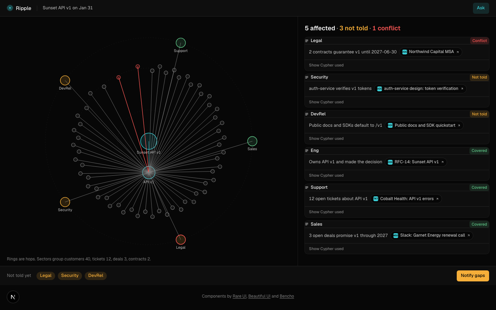
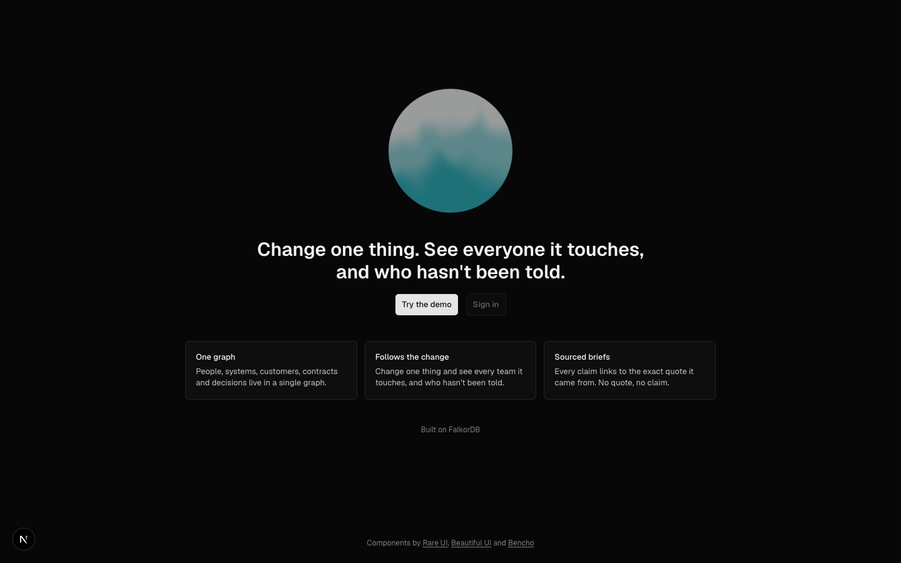
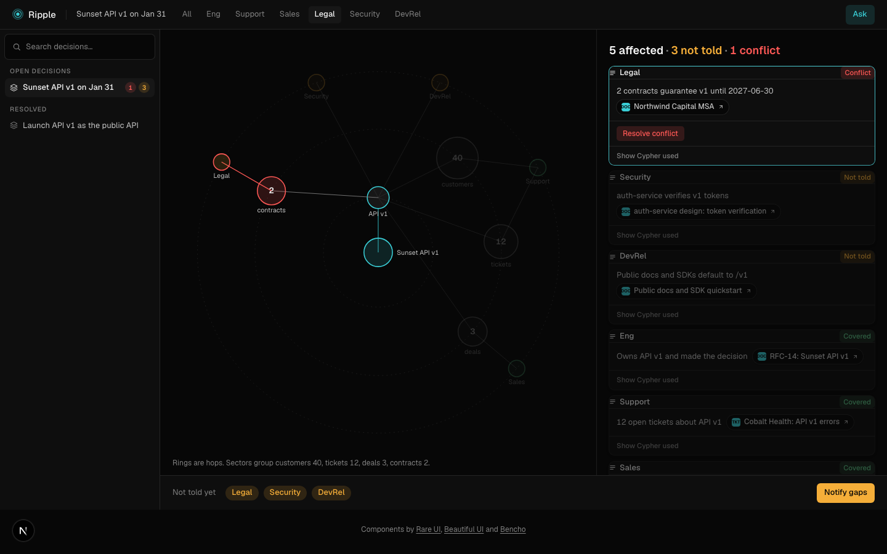
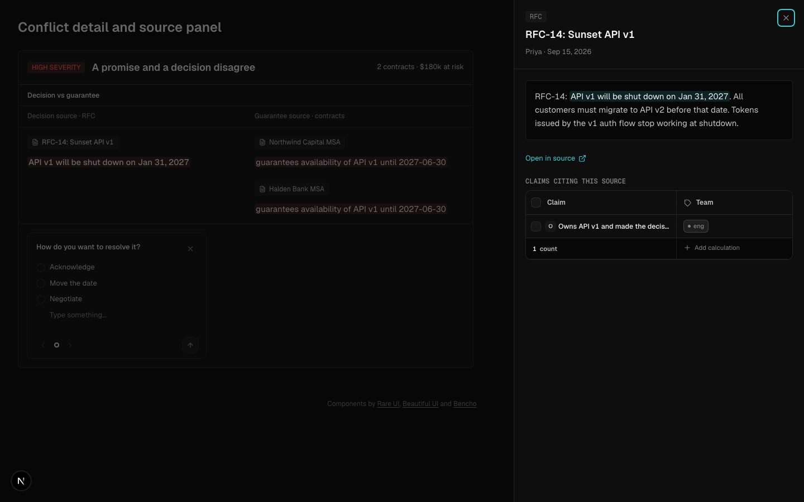
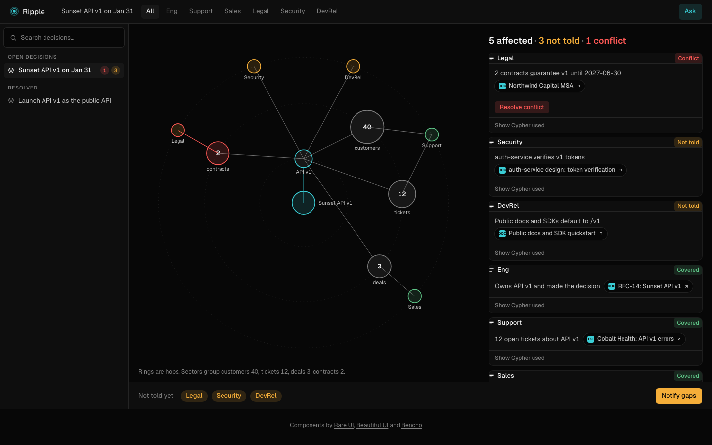
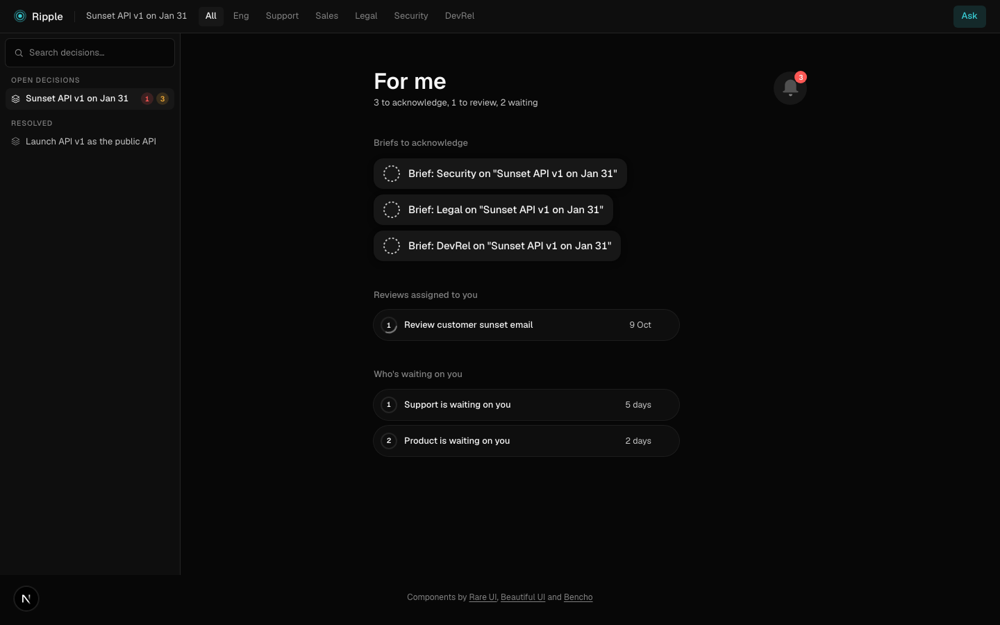
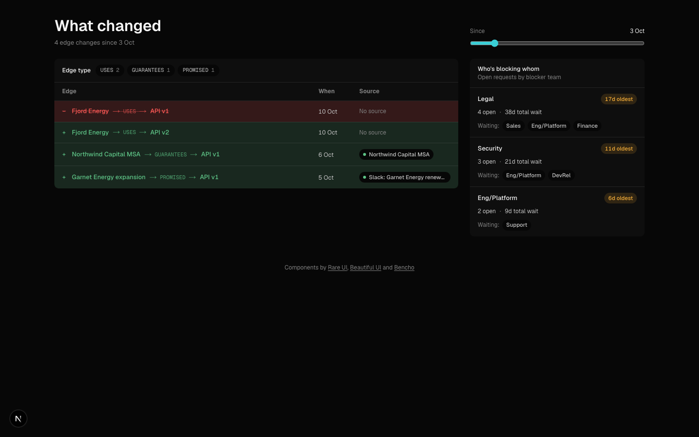
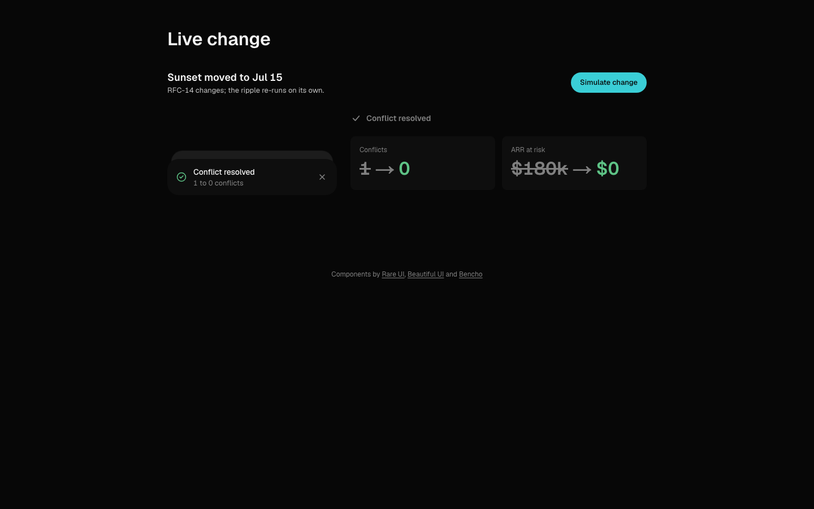
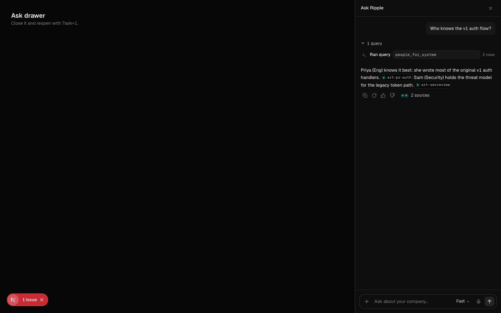
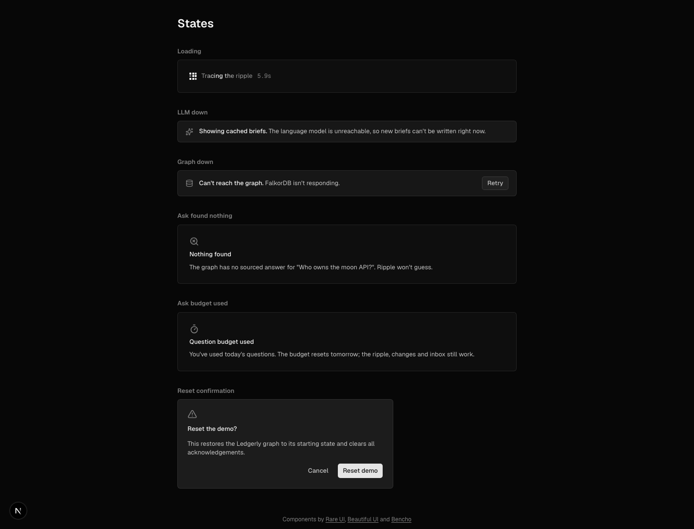

# Ripple

**A company brain on FalkorDB: change one decision and see every team, customer and contract it ripples into, with the receipts.**



Built for the WeMakeDevs x FalkorDB Graph Hacks, Track 03. Live demo data is a synthetic company, **Ledgerly**, that has just decided to sunset its API v1.

## What it does

- **The ripple.** Pick a decision ("Sunset API v1 on Jan 31"). One Cypher query walks decision, systems, their dependents, then tickets, deals, contracts, customers and the teams that own or handle them.
- **The gap.** Teams the decision hits but never reached (no `INVOLVED_IN`, no `ACKED`). For the v1 sunset: Legal, Security and DevRel.
- **Conflicts.** A contract that guarantees a system past the date a decision sunsets it is flagged, with both quotes. Here: the Northwind and Halden MSAs promise v1 until Jun 2027, the sunset is Jan 31, 180,000 ARR at risk.
- **Sourced briefs.** Each team gets a short brief. Every claim cites an artifact and a verbatim quote; a claim whose citation is not in the ripple rows is dropped.
- **Acks.** Each brief carries a signed link. One click ("seen", "concern", "not relevant") writes an `ACKED` edge and the gap shrinks.

Ask it as a team (what hits me?) and inside a team (who knows this?):

- Who knows a system best (authored, reviewed, handled evidence, scored).
- Which team is the bottleneck (open `WAITING_ON` requests, grouped by blocker).
- What changed since a date (edges added or ended, dated).
- Why was a decision made (`SUPPORTED_BY` artifacts).
- Ask drawer: the model picks one of six query templates and fills parameters; it never writes Cypher.

## Why FalkorDB is central

- **Multi-hop over 8+ node types in one query.** `ripple.cypher` crosses Decision, System, Ticket, Deal, Contract, Customer, Team and Person in a single Cypher statement (`DEPENDS_ON*0..2` plus entity hops, 12 `UNION ALL` branches).
- **Vector + full-text + graph in one query.** `search-vector.cypher` does a vector nearest-neighbour search on `Artifact.emb` and hops to the systems each hit is `ABOUT` in the same statement. Full-text search is a FalkorDB index on the same label.
- **One graph per company key.** `graphFor(tenant)` selects a graph by name; tenants are isolated with no row-level filters. The demo is graph `demo`.
- **Dated edges.** Every edge carries `valid_from` / `valid_to` (epoch ints), so "what changed" and "what was true then" are plain `WHERE` clauses, and moving the sunset date ends one edge and writes another.

Without FalkorDB the ripple would be a pile of joins across six systems, the conflict check a hand-written script, and the "who was never told" gap a set difference computed in application code.

## Architecture

One Next.js 16 app (UI plus route handlers) and one FalkorDB. No other services.

```
 browser ──► Next.js app (React UI, /api/* route handlers)
                │  lib/graph/queries.ts  (typed wrappers over *.cypher)
                │  lib/agent             (tool-calling loop, 6 templates)
                │  lib/briefs.ts         (claims + citation check)
                │  lib/ingest            (extract -> quote check -> cache; embed)
                ▼
            FalkorDB 6.0.2  (graph per company key: nodes, dated edges,
                             full-text index, 384-d vector index)
```

- **LLM: AI SDK, bring your own key** (Anthropic, OpenAI, Google, OpenRouter, OpenAI-compatible, Ollama). No key: the app runs on deterministic query wrappers and committed caches.
- **Embeddings are local**: MiniLM-L6-v2 (384-d) via `@huggingface/transformers`, cached by content hash in `lib/ingest/cache/embed`.

## Quickstart

Runs with no API key.

```bash
# FalkorDB 6.0.2 (Apple container)
container run -d --name falkor -p 6379:6379 -p 3000:3000 falkordb/falkordb:6.0.2
# or Docker
docker run -d --name falkor -p 6379:6379 -p 3000:3000 falkordb/falkordb:6.0.2

cp .env.example .env     # defaults point at localhost:6379; LLM_API_KEY may stay empty
pnpm i
pnpm seed                # builds graph `demo` from the committed caches
pnpm dev                 # http://localhost:3000 (map the FalkorDB browser to another port if 3000 is taken)
```

Set `LLM_PROVIDER` / `LLM_API_KEY` in `.env` to switch on the model-backed Ask drawer and brief rewording. Other scripts: `pnpm extract`, `pnpm embed`, `pnpm test`, `pnpm eval`.

## Graph data model

**Nodes** (label: properties). Artifacts carry two labels, `Artifact` plus their kind.

| Label | Properties |
|---|---|
| Team | id, name |
| Person | id, name, title, email, teamId, active |
| System | id, name, kind (api/service/repo), status, version, successor |
| Customer | id, name, arr, tier, region, monthlyCalls |
| Deal | id, name, stage, amount, closeDate, customerId |
| Contract | id, name, endsAt, customerId |
| Decision | id, title, status, decidedAt |
| Incident, Task | id plus title/status/timestamps |
| Artifact + Doc / Ticket / Message / PR | id, kind, title, text, ts, uri, author, emb (384-d vector), status (tickets) |
| Conflict | id, kind, severity, status, decisionId, contractIds, detectedAt, sources (JSON) |

**Edges**, grouped:

- Org: `MEMBER_OF`, `OWNS`, `CARES_ABOUT`, `MAINTAINS`, `ASSIGNED`, `CONTACT`
- Work evidence: `AUTHORED`, `REVIEWED`, `ABOUT`, `RAISED_BY`, `HANDLED_BY`, `ATTENDED`
- System graph: `DEPENDS_ON`, `USES`, `AFFECTED`, `CAUSED_BY`
- Commercial: `PROMISED`, `GUARANTEES`, `PARTY_TO`, `OWNED_BY`, `MANAGED_BY`
- Decisions: `SUNSETS`, `SUPPORTED_BY`, `SUPERSEDES`, `INVOLVED_IN`, `ACKED`, `BETWEEN`
- Process: `WAITING_ON`, `NOTIFIES`

**Rules**

- Every edge has `valid_from`, `valid_to` (absent/null = current) and `observed_at`. Ended edges are kept, not deleted.
- Extracted edges carry `src` (artifact id) and `quote`. A quote must be a verbatim substring of the artifact text; edges that fail the check are dropped (`quoteCheck` in `lib/ingest/extract.ts`).
- ACL fields: artifacts record `author`, and the ack link is a signed token scoped to one team and one decision. Graphs are separated per company key.
- All dates are epoch-second integers (`$now` is passed in), so no date arithmetic is needed in Cypher.

## Cypher we run

Every template in `lib/graph/queries/`, verbatim. The agent only chooses a template and fills parameters.

### `artifact-text.cypher`

Text of artifacts by id, to build verbatim citation quotes.

```cypher
// Text of artifacts by id, to build verbatim citation quotes.
MATCH (a:Artifact) WHERE a.id IN $ids
RETURN a.id AS id, a.text AS text
```

### `bottleneck.cypher`

Open WAITING_ON between teams, grouped by the team that is blocking.

```cypher
// Open WAITING_ON between teams, grouped by the team that is blocking.
MATCH (w:Team)-[r:WAITING_ON]->(b:Team)
WHERE r.valid_to IS NULL
RETURN b.id AS blockerTeamId, count(r) AS openRequests, sum($now - r.valid_from) AS totalWaitSecs,
  min(r.valid_from) AS oldestSince, collect(DISTINCT w.id) AS waitingTeamIds
ORDER BY totalWaitSecs DESC
```

### `change-sunset.cypher`

End the current SUNSETS edge of a decision and write its replacement.

```cypher
// End the current SUNSETS edge of a decision and write its replacement.
MATCH (d:Decision {id: $id})-[s:SUNSETS]->(x:System)
WHERE s.valid_to IS NULL
SET s.valid_to = $now
WITH d, x
CREATE (d)-[n:SUNSETS {on: $newOn, valid_from: $now, observed_at: $now}]->(x)
RETURN x.id AS systemId
```

### `conflicts-detect.cypher`

A contract guarantees a system past the date the decision sunsets it; both edges current.

```cypher
// A contract guarantees a system past the date the decision sunsets it; both edges current.
MATCH (d:Decision {id: $id})-[s:SUNSETS]->(sys:System)<-[g:GUARANTEES]-(c:Contract)
WHERE s.valid_to IS NULL AND g.valid_to IS NULL AND g.until > s.on
RETURN sys.id AS systemId, collect(c.id) AS contractIds,
  collect({artifactId: g.src, quote: g.quote}) AS guaranteeSources,
  head(collect(s.src)) AS sunsetSrc, head(collect(s.quote)) AS sunsetQuote
```

### `conflicts-list.cypher`

Conflict nodes for a decision.

```cypher
// Conflict nodes for a decision.
MATCH (k:Conflict {decisionId: $id})
RETURN k.id AS id, k.kind AS kind, k.severity AS severity, k.status AS status,
  k.decisionId AS decisionId, k.contractIds AS contractIds, k.detectedAt AS detectedAt, k.sources AS sources
ORDER BY k.id
```

### `conflicts-merge.cypher`

Idempotent: one Conflict per (decision, system), open, BETWEEN the decision and each contract.

```cypher
// Idempotent: one Conflict per (decision, system), open, BETWEEN the decision and each contract.
MERGE (k:Conflict {id: $cid})
ON CREATE SET k.detectedAt = $now
SET k.kind = 'sunset_vs_guarantee', k.severity = 'high', k.status = 'open',
    k.decisionId = $id, k.contractIds = $contractIds, k.sources = $sources
WITH k
MATCH (d:Decision {id: $id})
MERGE (k)-[b:BETWEEN]->(d)
ON CREATE SET b.valid_from = $now, b.observed_at = $now
WITH k
UNWIND $contractIds AS cid
MATCH (c:Contract {id: cid})
MERGE (k)-[b2:BETWEEN]->(c)
ON CREATE SET b2.valid_from = $now, b2.observed_at = $now
RETURN count(k) AS n
```

### `conflicts-resolve.cypher`

Open conflicts for this decision that were not re-detected are no longer true.

```cypher
// Open conflicts for this decision that were not re-detected are no longer true.
MATCH (k:Conflict {decisionId: $id, status: 'open'})
WHERE NOT k.id IN $keep
SET k.status = 'resolved'
RETURN count(k) AS n
```

### `create-tasks.cypher`

Demo graph only: one open Task per gap team, linked with NOTIFIES.

```cypher
// Demo graph only: one open Task per gap team, linked with NOTIFIES.
UNWIND $rows AS row
MATCH (t:Team {id: row.teamId})
MERGE (k:Task {id: row.id})
SET k.title = row.title, k.teamId = row.teamId, k.status = 'open', k.createdAt = $now
MERGE (k)-[n:NOTIFIES]->(t)
SET n.valid_from = $now, n.valid_to = null
RETURN k.id AS id, k.title AS title, t.id AS teamId
```

### `decision.cypher`

The decision node plus the evidence of its current SUNSETS edge, for assembling a RippleResult.

```cypher
// The decision node plus the evidence of its current SUNSETS edge, for assembling a RippleResult.
// One row per current SUNSETS edge (the wrapper takes the first).
MATCH (d:Decision {id: $id})
OPTIONAL MATCH (d)-[sn:SUNSETS]->(:System) WHERE sn.valid_to IS NULL
RETURN d.id AS id, d.title AS title, d.status AS status, d.decidedAt AS decidedAt,
  sn.src AS src, sn.quote AS quote
```

### `diff.cypher`

Edges added or ended after $since.

```cypher
// Edges added or ended after $since.
MATCH (a)-[r]->(b)
WHERE r.valid_from > $since OR r.valid_to > $since
RETURN a.id AS from, b.id AS to, type(r) AS type, r.valid_from AS validFrom, r.valid_to AS validTo,
  r.src AS src, r.quote AS quote
```

### `gap.cypher`

Per affected team: was it involved in, or did it acknowledge, the decision?

```cypher
// Per affected team: was it involved in, or did it acknowledge, the decision?
MATCH (t:Team) WHERE t.id IN $affected
OPTIONAL MATCH (t)-[i:INVOLVED_IN]->(:Decision {id: $id})
OPTIONAL MATCH (t)-[a:ACKED]->(:Decision {id: $id})
RETURN t.id AS team, t.name AS name, count(i) > 0 AS involved, count(a) > 0 AS acked
```

### `ripple.cypher`

Everything a decision touches: SUNSETS -> system <- DEPENDS_ON*0..2 dependents, then

```cypher
// Everything a decision touches: SUNSETS -> system <- DEPENDS_ON*0..2 dependents, then
// entities (tickets, deals, contracts, customers) and the teams that own/handle/care.
// Row: kind, ref, label, sys, hop, rel, team, reason, src, quote, amount. UNION ALL branches.
MATCH (d:Decision {id: $id})-[sn:SUNSETS]->(s:System)
WHERE sn.valid_to IS NULL
MATCH p = (s)<-[:DEPENDS_ON*0..2]-(x:System)
WHERE ALL(e IN relationships(p) WHERE e.valid_to IS NULL)
RETURN 'system' AS kind, x.id AS ref, x.name AS label,
  CASE WHEN length(p) = 0 THEN null ELSE nodes(p)[length(p) - 1].id END AS sys,
  length(p) + 1 AS hop, 'DEPENDS_ON' AS rel, null AS team, null AS reason, null AS src, null AS quote, 0 AS amount
UNION ALL
MATCH (d:Decision {id: $id})-[sn:SUNSETS]->(s:System)
WHERE sn.valid_to IS NULL
MATCH p = (s)<-[:DEPENDS_ON*0..2]-(x:System)
WHERE ALL(e IN relationships(p) WHERE e.valid_to IS NULL)
MATCH (a:Ticket {status: 'open'})-[r:ABOUT]->(x) WHERE r.valid_to IS NULL
RETURN 'ticket' AS kind, a.id AS ref, a.title AS label, x.id AS sys, length(p) + 2 AS hop, 'ABOUT' AS rel,
  null AS team, null AS reason, r.src AS src, r.quote AS quote, 0 AS amount
UNION ALL
MATCH (d:Decision {id: $id})-[sn:SUNSETS]->(s:System)
WHERE sn.valid_to IS NULL
MATCH p = (s)<-[:DEPENDS_ON*0..2]-(x:System)
WHERE ALL(e IN relationships(p) WHERE e.valid_to IS NULL)
MATCH (dl:Deal)-[r:PROMISED]->(x) WHERE r.valid_to IS NULL AND dl.stage <> 'closed_lost'
RETURN 'deal' AS kind, dl.id AS ref, dl.name AS label, x.id AS sys, length(p) + 2 AS hop, 'PROMISED' AS rel,
  null AS team, null AS reason, r.src AS src, r.quote AS quote, dl.amount AS amount
UNION ALL
MATCH (d:Decision {id: $id})-[sn:SUNSETS]->(s:System)
WHERE sn.valid_to IS NULL
MATCH p = (s)<-[:DEPENDS_ON*0..2]-(x:System)
WHERE ALL(e IN relationships(p) WHERE e.valid_to IS NULL)
MATCH (c:Contract)-[r:GUARANTEES]->(x) WHERE r.valid_to IS NULL
MATCH (c)-[:PARTY_TO]->(cu:Customer)
RETURN 'contract' AS kind, c.id AS ref, c.name AS label, x.id AS sys, length(p) + 2 AS hop, 'GUARANTEES' AS rel,
  null AS team, null AS reason, r.src AS src, r.quote AS quote, cu.arr AS amount
UNION ALL
MATCH (d:Decision {id: $id})-[sn:SUNSETS]->(s:System)
WHERE sn.valid_to IS NULL
MATCH p = (s)<-[:DEPENDS_ON*0..2]-(x:System)
WHERE ALL(e IN relationships(p) WHERE e.valid_to IS NULL)
MATCH (cu:Customer)-[r:USES]->(x) WHERE r.valid_to IS NULL AND r.last_seen >= $now - 120 * 86400
RETURN 'customer' AS kind, cu.id AS ref, cu.name AS label, x.id AS sys, length(p) + 2 AS hop, 'USES' AS rel,
  null AS team, null AS reason, r.src AS src, r.quote AS quote, cu.arr AS amount
UNION ALL
MATCH (d:Decision {id: $id})-[sn:SUNSETS]->(s:System)
WHERE sn.valid_to IS NULL
MATCH p = (s)<-[:DEPENDS_ON*0..2]-(x:System)
WHERE ALL(e IN relationships(p) WHERE e.valid_to IS NULL)
MATCH (t:Team)-[r:OWNS]->(x) WHERE r.valid_to IS NULL AND NOT (t)-[:OWNS]->(s)
RETURN 'team' AS kind, x.id AS ref, x.name AS label, x.id AS sys, 0 AS hop, 'OWNS' AS rel,
  t.id AS team, 'owns ' + x.name + ', which depends on ' + s.name AS reason, r.src AS src, r.quote AS quote, 0 AS amount
UNION ALL
MATCH (d:Decision {id: $id})-[sn:SUNSETS]->(s:System)
WHERE sn.valid_to IS NULL
MATCH p = (s)<-[:DEPENDS_ON*0..2]-(x:System)
WHERE ALL(e IN relationships(p) WHERE e.valid_to IS NULL)
MATCH (t:Team)-[r:CARES_ABOUT]->(x) WHERE r.valid_to IS NULL
RETURN 'team' AS kind, x.id AS ref, x.name AS label, x.id AS sys, 0 AS hop, 'CARES_ABOUT' AS rel,
  t.id AS team, 'cares about ' + x.name AS reason, r.src AS src, r.quote AS quote, 0 AS amount
UNION ALL
MATCH (d:Decision {id: $id})-[sn:SUNSETS]->(s:System)
WHERE sn.valid_to IS NULL
MATCH p = (s)<-[:DEPENDS_ON*0..2]-(x:System)
WHERE ALL(e IN relationships(p) WHERE e.valid_to IS NULL)
MATCH (a:Ticket {status: 'open'})-[r:ABOUT]->(x) WHERE r.valid_to IS NULL
MATCH (a)-[:HANDLED_BY]->(:Person)-[:MEMBER_OF]->(t:Team)
RETURN 'team' AS kind, a.id AS ref, a.title AS label, x.id AS sys, 0 AS hop, 'HANDLED_BY' AS rel,
  t.id AS team, 'handles open tickets about ' + x.name AS reason, r.src AS src, r.quote AS quote, 0 AS amount
UNION ALL
MATCH (d:Decision {id: $id})-[sn:SUNSETS]->(s:System)
WHERE sn.valid_to IS NULL
MATCH p = (s)<-[:DEPENDS_ON*0..2]-(x:System)
WHERE ALL(e IN relationships(p) WHERE e.valid_to IS NULL)
MATCH (a:Ticket {status: 'open'})-[r:ABOUT]->(x) WHERE r.valid_to IS NULL
MATCH (a)-[:HANDLED_BY]->(t:Team)
RETURN 'team' AS kind, a.id AS ref, a.title AS label, x.id AS sys, 0 AS hop, 'HANDLED_BY' AS rel,
  t.id AS team, 'handles open tickets about ' + x.name AS reason, r.src AS src, r.quote AS quote, 0 AS amount
UNION ALL
MATCH (d:Decision {id: $id})-[sn:SUNSETS]->(s:System)
WHERE sn.valid_to IS NULL
MATCH p = (s)<-[:DEPENDS_ON*0..2]-(x:System)
WHERE ALL(e IN relationships(p) WHERE e.valid_to IS NULL)
MATCH (dl:Deal)-[r:PROMISED]->(x) WHERE r.valid_to IS NULL AND dl.stage <> 'closed_lost'
MATCH (dl)-[:OWNED_BY]->(t:Team)
RETURN 'team' AS kind, dl.id AS ref, dl.name AS label, x.id AS sys, 0 AS hop, 'OWNED_BY' AS rel,
  t.id AS team, 'owns open deals that promised ' + x.name AS reason, r.src AS src, r.quote AS quote, 0 AS amount
UNION ALL
MATCH (d:Decision {id: $id})-[sn:SUNSETS]->(s:System)
WHERE sn.valid_to IS NULL
MATCH p = (s)<-[:DEPENDS_ON*0..2]-(x:System)
WHERE ALL(e IN relationships(p) WHERE e.valid_to IS NULL)
MATCH (c:Contract)-[r:GUARANTEES]->(x) WHERE r.valid_to IS NULL
MATCH (c)-[:MANAGED_BY]->(t:Team)
RETURN 'team' AS kind, c.id AS ref, c.name AS label, x.id AS sys, 0 AS hop, 'MANAGED_BY' AS rel,
  t.id AS team, 'manages contracts that guarantee ' + x.name AS reason, r.src AS src, r.quote AS quote, 0 AS amount
```

### `search-vector.cypher`

Hybrid: nearest Artifacts by embedding, then hop to the systems they are ABOUT.

```cypher
// Hybrid: nearest Artifacts by embedding, then hop to the systems they are ABOUT.
CALL db.idx.vector.queryNodes('Artifact', 'emb', $k, vecf32($vec)) YIELD node, score
OPTIONAL MATCH (node)-[:ABOUT]->(s:System)
RETURN node.id AS id, node.kind AS kind, node.title AS title, score, collect(s.id) AS systemIds
ORDER BY score
```

### `search.cypher`

Full-text over Artifact.text.

```cypher
// Full-text over Artifact.text.
CALL db.idx.fulltext.queryNodes('Artifact', $text) YIELD node, score
RETURN node.id AS id, node.kind AS kind, node.title AS title, score
ORDER BY score DESC LIMIT 10
```

### `trace-decision.cypher`

A decision and the artifacts that support it (SUPPORTED_BY, with the edge quote when present).

```cypher
// A decision and the artifacts that support it (SUPPORTED_BY, with the edge quote when present).
MATCH (d:Decision {id: $id})
OPTIONAL MATCH (d)-[r:SUPPORTED_BY]->(a:Artifact) WHERE r.valid_to IS NULL
RETURN d.id AS id, d.title AS title, d.status AS status, d.decidedAt AS decidedAt,
  a.id AS sourceId, a.title AS sourceTitle, r.quote AS quote
```

### `who-knows.cypher`

Active people with PRs (AUTHORED|REVIEWED) ABOUT the system, or tickets about it HANDLED_BY them.

```cypher
// Active people with PRs (AUTHORED|REVIEWED) ABOUT the system, or tickets about it HANDLED_BY them.
// One evidence row per (person, role, artifact); the wrapper scores and takes the top 5.
MATCH (p:Person {active: true})-[r:AUTHORED]->(a)
WHERE a.id = $id OR (a)-[:ABOUT]->(:System {id: $id})
RETURN p.id AS personId, 'authored' AS role, a.id AS id, coalesce(a.ts, r.valid_from) AS ts
UNION ALL
MATCH (p:Person {active: true})-[r:REVIEWED]->(a)
WHERE a.id = $id OR (a)-[:ABOUT]->(:System {id: $id})
RETURN p.id AS personId, 'reviewed' AS role, a.id AS id, coalesce(a.ts, r.valid_from) AS ts
UNION ALL
MATCH (h:Ticket)-[:HANDLED_BY]->(p:Person {active: true})
WHERE (h)-[:ABOUT]->(:System {id: $id})
RETURN p.id AS personId, 'handled' AS role, h.id AS id, h.ts AS ts
```

## FalkorDB gotchas we hit

- **`--` comments fail.** Use `//`.
- **Old full-text procedure.** Create the index with `CREATE FULLTEXT INDEX FOR (a:Artifact) ON (a.text)`, query with `db.idx.fulltext.queryNodes`.
- **Vector index** needs `OPTIONS {dimension:384, similarityFunction:'cosine'}`. The returned `score` is a distance, so `ORDER BY score` ascending.
- **No label OR in `MATCH`** (`(:A|:B)` fails), but relationship OR (`-[:A|B]->`) works. That is why artifacts get a shared `Artifact` label.
- **No date arithmetic**: store epoch ints and pass `$now`; `r.last_seen >= $now - 120 * 86400` works on ints.
- **Aggregates**: a `count()` next to non-aggregated columns groups by them, so `gap.cypher` uses `count(i) > 0` after `OPTIONAL MATCH`; collecting maps works (`collect({artifactId: g.src, ...})`), and `head(collect(x))` picks one value per group. `ripple.cypher` avoids one big aggregate: it is `UNION ALL` branches with a single row shape, and the wrapper groups and dedupes in TypeScript.
- **Bundling the client breaks the Next build** (`a.BigInt is not a function`): list `falkordb` and `@redis/client` in `serverExternalPackages`.

## Eval

`pnpm eval` runs 15 questions about Ledgerly against the `demo` graph using the deterministic query wrappers (no LLM). Each question names its tool and expected source artifact ids; a row passes only if the answer matches and every expected source id is returned. `lib/eval/eval.test.ts` runs the same harness on a throwaway `test_v_<uuid>` graph.

| # | Question | Answer | Tool | Sources ok | Pass |
|---|---|---|---|---|---|
| 1 | Who knows the v1 auth flow best? | p-priya | who-knows (api-v1) | yes | PASS |
| 2 | Who has handled the most v1 tickets? | p-ana | who-knows (api-v1) | yes | PASS |
| 3 | Who reviewed Priya's v1 pull requests? | p-sam | who-knows (api-v1) | yes | PASS |
| 4 | Which contracts still promise v1 past the sunset? | ctr-1, ctr-2 | conflicts-detect | yes | PASS |
| 5 | Which document set the Jan 31 sunset date? | art-rfc14 | conflicts-detect | yes | PASS |
| 6 | What is the gap for the v1 sunset (teams hit but never told)? | devrel, legal, security | gap | yes | PASS |
| 7 | Which teams does the v1 sunset ripple into? | devrel, legal, sales, security, support | ripple | yes | PASS |
| 8 | How much ARR is at risk from the open conflict? | 180000 | ripple + conflicts-detect | yes | PASS |
| 9 | How many open conflicts does the sunset have? | 1 | conflicts-list | yes | PASS |
| 10 | How many open tickets are about v1? | 12 | ripple | yes | PASS |
| 11 | How many open deals promised v1? | 3 | ripple | yes | PASS |
| 12 | Why is Security in the ripple? | owns auth-service, which depends on API v1 | ripple | yes | PASS |
| 13 | Which team blocks the most open requests? | legal | bottleneck | yes | PASS |
| 14 | Who is waiting on Legal? | eng, finance, product, sales | bottleneck | yes | PASS |
| 15 | Which artifact mentions Northwind (full-text)? | art-msa-northwind | search | yes | PASS |

15/15 passed

## Screens

| | |
|---|---|
|  Landing |  The ripple, with the gap chips |
|  One team's slice of the ripple |  A conflict with its two quotes |
|  Decision sidebar |  The per-team brief email |
|  One-click ack |  Expired ack link |
|  Team inbox |  What changed (dated edges) |
|  Moving the sunset date resolves the conflict |  Ask drawer |
|  Ask, streaming with tool calls |  Empty, loading and error states |

## Deploy

See [docs/deploy.md](docs/deploy.md) (Zerops: `web` Next.js standalone plus a `falkordb` docker service; a Caddy/Docker fallback is in `deploy/fallback`).

## Honest limits

- The data is **synthetic** (Ledgerly), not a real company.
- The extraction cache is **seeded from mocks** until an API key is set; with a key, `pnpm extract` fills it from the model, and every edge still passes the quote check.
- **Single tenant in the demo**: the graph-per-key design is there, but the demo uses one graph (`demo`) and no sign-in is required.
- Slack and Jira connectors are v1: today artifacts come from the seed, not live sources.

## Licence

MIT for Ripple's own code, see `LICENSE`. The component kits keep their own licences, see `THIRD_PARTY_NOTICES.md`.

## Third-party components

Kit components live in `components/kit/<kit>/`, restyled to the Ripple tokens, each with its licence file. See `THIRD_PARTY_NOTICES.md`.

| Kit | Licence | Link |
| --- | --- | --- |
| Rare UI (`components/kit/rareui`) | MIT + Commons Clause + Attribution (not covered by Ripple's MIT licence) | https://rareui.com |
| Beautiful UI (`components/kit/beautifului`) | MIT | https://www.beautifului.dev |
| Bencho, free blocks only (`components/kit/bencho`) | MIT | https://bencho.dev |

Components by [Rare UI](https://rareui.com), [Beautiful UI](https://www.beautifului.dev) and [Bencho](https://bencho.dev).
